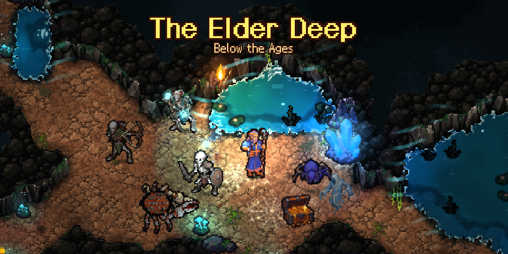
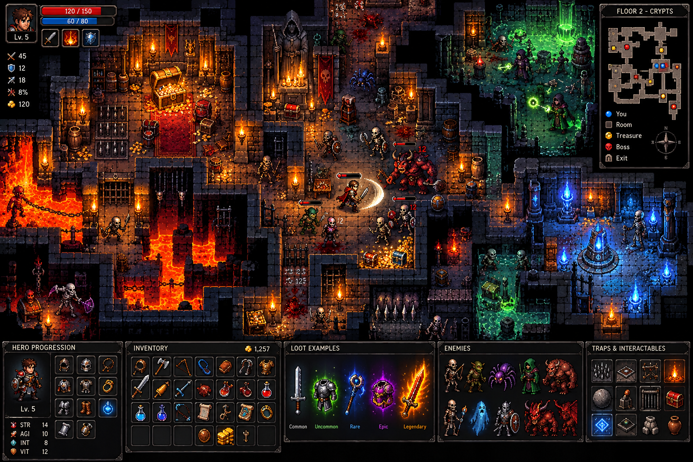

# The Elder Deep: Below the Ages



Тёмное фэнтези-подземелье в пиксель-арте: вид сверху 3/4, процедурные этажи, лут, способности и прогресс между забегами.
Играть можно в браузере (свой движок на WebGL2, без сборки и зависимостей) или в готовой настольной сборке.

## Об игре

Поход начинается в городе у костра. Там берут задания, чинят и зачаровывают снаряжение, тратят осколки душ на улучшения и спускаются в подземелье через ворота. Дальше 16 этажей кампании, а после последнего босса лестница ведёт в бесконечный спуск.

- **Этажи и биомы.** Подземелье (1–2), Крипты (3–4), Огненные глубины (5–6), Чертоги (7–8), Затопленные пещеры (9–12) и Магмовые пещеры (13–16).
- **Боссы.** Королева пауков (2-й этаж), Верховный некромант (4), Владыка горна (6), Повелитель демонов (8), Глубинный змей (12) и Магмовый колосс (16). Арены запираются до победы.
- **Бесконечный спуск.** После колосса спуск продолжается без конца: биомы идут парами, на каждой паре свой страж или босс. Только здесь на этажах встречаются свойства: «Затопленный», «Без света», «Логово», «Проклятый», «Тихий».
- **Карты.** Каждый этаж собирается заново: комнаты и коридоры, особые залы, ловушки, лава и вода, тайники, рычаги, двери с замками, пленники в клетках.
- **Враги.** Скелеты и скелеты-лучники, гоблины, пауки, культисты, призраки, демоны, в пещерах крабы, угри, слизни и утопленники, в магме саламандры и големы. Бывают элитные, с особыми свойствами. Все с анимированными ригами.
- **Лут.** Восемь слотов: оружие, вторая рука, шлем, броня, перчатки, сапоги, кольцо, амулет. Пять редкостей от обычной до легендарной, случайные свойства, зелья, свитки возвращения.
- **Дары.** Алтари на этажах дают дары, которые меняют стиль боя. Способности растут до 15 ранга, на 3 и 6 рангах выбирают одно из двух улучшений.
- **Сохранения.** Пять слотов. В браузере они лежат в `localStorage`, в настольной сборке в папке данных приложения.

### Герои

| Класс | Оружие | Умения (1, 2, 3) | Ресурс |
|---|---|---|---|
| Воин | меч, топор, молот и щиты | Вихрь клинка, Рывок-удар, Боевой клич | ярость растёт в бою и тает без него |
| Лучник | короткий и длинный лук, арбалет, колчан | Залп, Капкан, Отскок | попадания копят ману, крит даёт больше |
| Маг | посох, жезл, сфера | Огненный шар, Магический щит, Ледяная волна | мана; посох бьёт без неё, а вплотную им можно ударить |

Перед новым забегом выбирают сложность (лёгкая, нормальная, тяжёлая), имя героя и режим смерти.

### Город и задания

В городе живут Старейшина, Кузнец, Чародейка, Торговец, Страж и ещё несколько горожан. Часть из них сидит в клетках на этажах, и сначала их нужно освободить.

- Доска заданий, журнал и трекер: убить, зачистить комнаты, найти вещь, добыть именного врага, спуститься глубже. Старейшина ведёт цепочку заданий на боссов.
- Кузнец перековывает свойства вещи, Чародейка зачаровывает.
- Торговец покупает и продаёт, на этажах иногда встречается бродячий.
- Сундук-хранилище держит вещи, которые жалко брать вниз.
- Алтарь душ: осколки душ, собранные за забеги, превращаются в постоянные улучшения (здоровье, урон, зелья, золото, мана, подсумки и другое).

### Режимы смерти

В обычном режиме герой просыпается в городе и может вернуться вниз. В хардкоре смерть заканчивает забег. Режим выбирают на экране нового забега, и он остаётся с этим забегом.

Меню «Тесты» открывается клавишей <kbd>`</kbd> в главном меню: оттуда можно сразу запустить пещеры, магму или бесконечный спуск.

## Управление

| Клавиша | Действие |
|---|---|
| WASD / стрелки | движение |
| ЛКМ | атака в сторону курсора |
| ПКМ | основное умение класса: вихрь, огненный шар или залп |
| 1 2 3 | способности |
| Пробел | рывок |
| Q / R | зелье здоровья / маны |
| T | свиток возвращения в город |
| E | действие: сундук, торговец, разговор, лестница, алтарь |
| I / C / Tab | экран героя и сумка |
| J | журнал заданий |
| L | легенда карты |
| M | звук вкл/выкл |
| Esc | пауза; закрывает открытое окно |
| F11 | полный экран |

### Геймпад

Работает вместе с клавиатурой и мышью, подсказки в игре показывают кнопки пада. Названия как на Steam Deck.

| Кнопка | В бою | В меню |
|---|---|---|
| Левый стик | движение | выбор кнопки |
| Правый стик | прицел вокруг героя | свободный курсор |
| R2 | атака (удержание) | нажать |
| L2 | основное умение класса | правый клик |
| A | действие (E) | нажать / подтвердить |
| B | рывок | назад (Esc) |
| Y / R1 / L1 | способности 1 / 2 / 3 | Y: правый клик |
| X | не занята | не занята |
| Крестовина | ↑ зелье здоровья, ↓ зелье маны, ← свиток, → журнал | выбор кнопки |
| View / Menu | экран героя / пауза | закрыть / пауза |
| L3 / R3 | звук / строка диагностики | |

Если правый стик не трогать, прицел следует за движением. В сумке вещь переносят, удерживая A и ведя курсор крестовиной.

### Steam Deck

Пад работает в любом способе запуска, и в браузере, и в Electron. Чтобы Deck отдавал его как геймпад, добавьте запуск в Steam («Добавить стороннюю игру») и в свойствах ярлыка выберите раскладку «Геймпад».
Раскладку рабочего стола и «Геймпад» вместе не включайте: на рабочем столе Steam отдаёт и пад, и Enter от A, и одно нажатие сработает дважды.

`./deck.sh` поднимает локальный сервер и открывает игру в Chrome (Flatpak) на весь экран, с Vulkan-бэкендом ANGLE. `DECK_ANGLE=gl ./deck.sh` вернёт OpenGL.
Порт сервера постоянный (8930), потому что сохранения привязаны к адресу. Замеры в `docs/perf-1370.md`.
Строка диагностики (R3 или F2) показывает, видит ли браузер пад. «Настройки → Графика» на средней и низкой убирает часть мелких эффектов, на Deck это экономит 2–4 мс на тяжёлых этажах.

## Запуск

### Настольная сборка

Готовые сборки лежат в [релизах на GitHub](https://github.com/svsq/dungeon-game/releases): macOS (универсальный dmg и zip), Windows 10+ (установщик), Windows 7 (отдельный установщик) и Linux (AppImage).
Игра сама находит новую версию: пункт обновления появляется в главном меню. Сборка устроена в `desktop/` на Electron (`desktop/release.sh`).

### В браузере

Нужен статический HTTP-сервер: WebGL не загружает текстуры по `file://`. `start.command` (macOS) и `start.sh` (Linux) поднимают его сами и открывают игру.
Сервер `tools/serve.py` написан на Python 3.8+ без зависимостей. Обычный `python3 -m http.server` не подходит: под сотнями файлов на старте он рвал соединения, и игра падала на случайном файле.

```sh
git clone https://github.com/svsq/dungeon-game.git
cd dungeon-game
python3 tools/serve.py 8930
```

Затем откройте <http://127.0.0.1:8930/live/index.html>. Игра откроется на главном меню.

Открытая страница сама перезагружается при изменении исходников, состояние игры при этом сохраняется. Клавиши разработчика: <kbd>P</kbd> пауза, <kbd>[</kbd> <kbd>]</kbd> скорость, <kbd>.</kbd> шаг на один кадр, <kbd>F2</kbd> строка диагностики.

## Проверки

Тестов в привычном смысле нет, вместо них набор скриптов, которые запускаются из корня проекта.

```sh
node live/tune.cjs                  # демо-заставка без браузера, инварианты симуляции и уровня (selfCheck)
node tools/textcheck.cjs            # все тексты лежат в live/text_*.js, ключи на месте, кириллицы в коде нет
node tools/playtest.cjs [seed] --profile novice|average|expert|mage|builder --runs N   # бот проходит кампанию, статистика по этажам
node tools/difficulty.cjs --seeds 1-40 --runs N                                        # профили ботов на сидах, ориентир для баланса
node tools/swingcheck.mjs           # плавность замаха героя
node tools/motioncheck.mjs          # анимации героя и монстров: труп, рука, вздрагивание, дыхание, каст
node tools/lootvis.mjs              # весь лут на полу виден: не за предметом и не в темноте
node tools/cavecheck.mjs            # пещеры и магма отрисовываются без ошибок
node tools/brawlcheck.mjs           # плотный бой: тексты, полосы здоровья, вспышки попаданий
node tools/spellcheck.mjs           # вихрь, огненный шар и взрыв: пиксельная сетка, прозрачность, подпалины
node tools/bossvis.mjs              # видимость короны Королевы и кладок в игровом масштабе
```

Скрипты с браузером используют Playwright из набора ref2game, кадры и отчёты складывают в `frames/`.
`node tools/cover.mjs` собирает обложку `docs/cover.png` из текущей игры.

`difficulty.cjs` умеет сохранять каждый забег (`--json-out frames/balance.json`), продолжать прерванную серию (`--resume`) и пересчитывать таблицы без запуска ботов (`--from-json`). `--check` проверяет приёмку баланса и отклоняет серию с зависшими или пропущенными забегами. `--quiet` ограничивает запуск двумя процессами с низким приоритетом.

## Устройство

| Путь | Что там |
|---|---|
| `live/` | игра: `sim*.js` (детерминированная симуляция, 120 Гц), `dungeon*.js` (генератор этажей), `data*.js` (контент и баланс), `scene*.js`, `monsters.js`, `hud*.js` (отрисовка), `gl.js`, `lib.js` (движок), `text_*.js` (все тексты) |
| `live/assets/` | готовые к движку текстуры (генерируются из `art/gen`) |
| `art/gen/` | исходный арт, сгенерированный ИИ; промпты в `art/prompts/`, стиль в `art/style_bible.txt` |
| `study/` | разбор концепта: палитра, значения, тайлы |
| `tools/` | скрипты для нарезки ригов, правки спрайтов и проверок |
| `desktop/` | сборка на Electron и обновления |
| `docs/` | заметки, мир игры, замеры |
| `ARCHITECTURE.md` | устройство кода |
| `CHANGELOG.md` | что менялось от версии к версии |
| `TASKS.md`, `TASKS_COMPLETED.md` | открытые и сделанные задачи |

Симуляция не знает про экран: отрисовка читает её состояние и ничего в нём не меняет, поэтому кадр можно получить без игры, по времени и состоянию.

## Концепт



Концепт-арт, по которому сделана игра: стиль, палитра, масштаб и композиция кадра.

Проект сделан с помощью Claude Code и скилла **ref2game**. Арт создан генератором изображений по концепту и стайл-гайду.
Анимация, свет, эффекты и геймплей написаны кодом.
