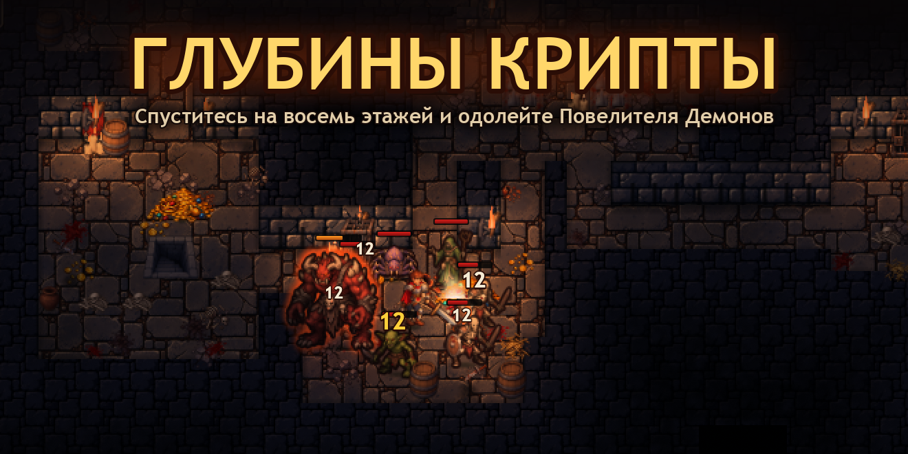
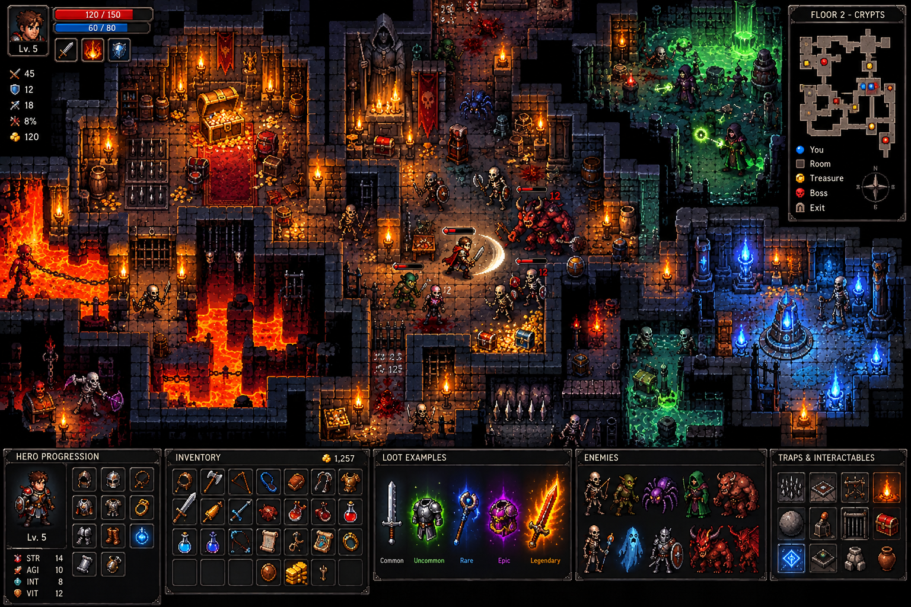

# Глубины Крипты



Тёмное фэнтези-подземелье в пиксель-арте: вид сверху 3/4, процедурные этажи, лут, способности и прогресс между забегами.
Игра работает в браузере на собственном движке WebGL2 без сборки и зависимостей.

## Об игре

- **8 этажей, 4 биома:** Подземелье (1–2), Крипты (3–4), Огненные глубины (5–6), Чертоги (7). На 8-м этаже, в Троне Демона, ждёт Повелитель Демонов.
- **Процедурная генерация:** на каждом этаже новая карта с комнатами, коридорами и особыми комнатами (крипта, магический зал, сокровищница, безопасная комната, лавка), ловушками и лавой.
- **Враги:** скелеты, гоблины, пауки, культисты, призраки, демоны и их элитные версии. У всех анимированные риги.
- **Лут:** оружие и броня в 8 слотах, 5 уровней редкости от обычного до легендарного, случайные свойства, зелья и свитки.
- **Развитие:** уровни, характеристики (сила, ловкость, интеллект, живучесть) и три способности: Вихрь клинка, Огненный шар, Магический щит.
- **Мета-прогресс:** осколки душ, собранные за забег, тратятся на постоянные улучшения у Алтаря душ.
- **Сохранения:** забег и мета-прогресс хранятся в `localStorage`.

## Управление

| Клавиша | Действие |
|---|---|
| WASD / стрелки | движение |
| ЛКМ | атака в сторону курсора |
| 1 2 3 | способности |
| Пробел | рывок |
| Q / R | зелье здоровья / маны |
| E | действие: открыть сундук, говорить с торговцем, спуститься по лестнице |
| I | экран героя |
| Esc | пауза |

## Запуск

Нужен любой статический HTTP-сервер: WebGL не загружает текстуры по `file://`.

```sh
git clone https://github.com/svsq/dungeon-game.git
cd dungeon-game
python3 -m http.server 8930
```

Затем откройте <http://127.0.0.1:8930/live/index.html>. Пока не нажата клавиша, идёт демо-заставка.

Открытая страница сама перезагружается при изменении исходников, а состояние игры при этом сохраняется. Клавиши разработчика:
`P` — пауза, `[` `]` — скорость, `.` — шаг на один кадр.

## Проверки

```sh
node live/tune.cjs          # демо-заставка без браузера + проверка инвариантов уровня (selfCheck)
node tools/playtest.cjs 1   # бот проходит всю кампанию с сидом 1 и печатает статистику по этажам
```

## Устройство

| Путь | Что там |
|---|---|
| `live/` | игра: `sim.js` (детерминированная симуляция, 120 Гц), `dungeon.js` (генератор этажей), `data.js` (контент и баланс), `scene.js` / `monsters.js` / `hud.js` (отрисовка), `gl.js` / `lib.js` (движок) |
| `live/assets/` | готовые к движку текстуры (генерируются из `art/gen`) |
| `art/gen/` | исходный арт, сгенерированный ИИ; промпты в `art/prompts/`, стиль в `art/style_bible.txt` |
| `study/` | разбор концепта: палитра, значения, тайлы |
| `tools/` | скрипты для нарезки ригов, правки спрайтов и проверок |
| `TASKS.md` | задачи: баги, замечания и улучшения со статусами |

## Концепт



Концепт-арт, по которому сделана игра: стиль, палитра, масштаб и композиция кадра.

Проект сделан с помощью Claude Code и скилла **ref2game**. Арт создан генератором изображений по концепту и стайл-гайду.
Анимация, свет, эффекты и геймплей написаны кодом.
