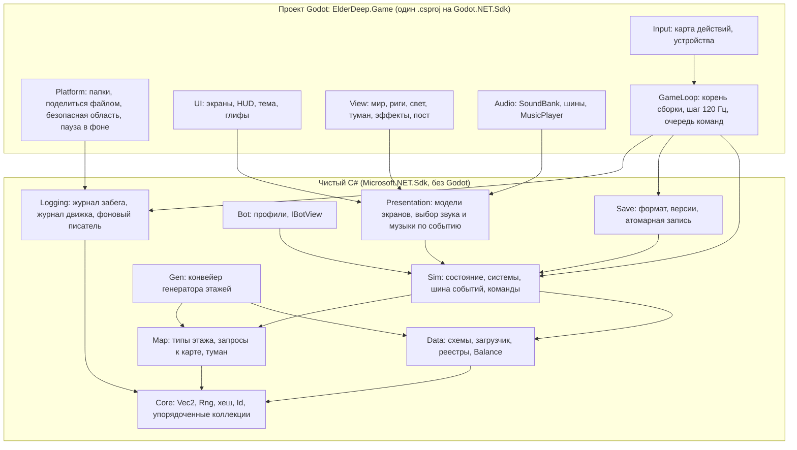
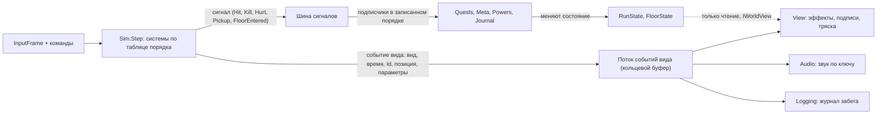
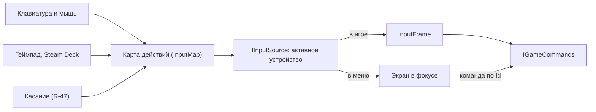

# Архитектура порта «The Elder Deep» на Godot 4.7 + C# (задача 2052): черновик

Дата: 15.11.2026. Черновик для ревью автора. Вход: `study/port/requirements.md` (дальше «требования», ссылки вида «треб. 2.3» и «вопрос 11»), `study/port/prototype.md`, `study/refactor2/*.md`, `ARCHITECTURE.md`, код прототипа `elderdeep-godot/`. Решения автора из разделов 1 и 3 требований здесь не обсуждаются, а применяются. Кода порта в документе нет: только слои, границы, имена типов и правила.

Как читать. Всё, что написано утвердительно, это предложение архитектуры, если рядом нет ссылки на решение автора. Развилки, где нужен твой ответ, собраны в разделе 15. Термины расшифрованы при первом упоминании и в глоссарии в конце.

Правила кода (CLAUDE.md, «Engineering principles») служат критерием для каждого раздела: числа со смыслом живут в данных или в именованных константах; повторяющееся дважды выносится; новая фича добавляется файлом или записью, а не правкой общего `switch`; блоки маленькие, с явными входами, без скрытого глобального состояния; симуляция не зависит от Godot.

## 1. Обзор в одном экране

Игра делится на две части. **Чистый C#** (обычные библиотеки .NET, ни одной ссылки на `Godot.*`): правила игры, данные, генератор этажей, сохранения, журналы, бот. **Проект Godot**: всё, что рисует, звучит, читает ввод и знает про платформу. Чистая часть собирается и тестируется командой `dotnet test` без редактора и без окна.

Зависимости идут только вниз. Нижний слой ничего не знает о верхнем. Наверх информация поднимается одним способом: нижний слой публикует **события** (записи «что произошло»), верхний их читает.



Три правила границы:

1. Модули (проекты C#, см. 2.2) из нижнего блока не ссылаются на Godot. Это проверяет компилятор: у них другой SDK, типа `Godot.Node` в них просто нет. Проверка `layercheck.cjs` по регулярным выражениям становится ошибкой сборки (tools R-1).
2. Узлы Godot не меняют состояние игры. Они читают его через интерфейс только для чтения `IWorldView` и отправляют команды через `IGameCommands`.
3. Симуляция не вызывает вид. Она кладёт события в поток, вид забирает их в своём кадре.

## 2. Репозиторий и модули

### 2.1 Репозиторий

Порт живёт в отдельном репозитории `elderdeep-godot` (решение автора, вопрос 17). Общих файлов с `game-demo` нет: данные, арт, звуки и эталоны переносятся копией один раз (разделы 4 и 11). В репозитории прототипа пока нет ни одного коммита, поэтому структуру можно задать сразу.

```
elderdeep-godot/
  ElderDeep.sln
  src/                 чистый C#: по папке на модуль
  game/                проект Godot: project.godot, ElderDeep.Game.csproj, сцены, шейдеры
    data/              JSON данных игры (источник правды после экспорта из JS)
    art/  sounds/  locale/  shaders/  screens/  world/
    bench/             сцена замеров из прототипа (метод drawn=, bench.txt, --auto, --stress)
  tests/               тестовые проекты и golden/ (эталоны, снятые с JS)
  tools/               консольные программы: баланс, сверка эталонов, сборка атласов
  build/               вывод экспорта (вне git)
```

Папка `src/` лежит вне `game/`, чтобы редактор Godot не сканировал и не импортировал исходники библиотек и тестов.

Из прототипа по решению автора (вопрос 1) берётся то, что ложится на эту схему: метод замера (переезжает в `game/bench/` как постоянная сцена для проверки бюджетов), построение рига из частей и шарниров (`Rig.cs` как отправная точка для раздела 7.3), настройки `project.godot` (Compatibility, `canvas_items` и `expand`, сжатие ETC2/ASTC и S3TC/BPTC, мипкарты по умолчанию) и пресеты экспорта. `Main.cs` (сцена, собранная одним файлом на 575 строк, с числами в коде) в порт не идёт; `RigData.cs` заменяется данными ригов в JSON (tools R-10).

### 2.2 Модули

Модуль = проект C# (в терминах .NET сборка, assembly): один `.csproj`, одна `.dll`.

| Модуль | Что внутри | Ссылается на |
|---|---|---|
| `ElderDeep.Core` | `Vec2` на `double`, `Rng`, целочисленный хеш, типизированные `Id`, `OrderedSet`, `OrderedMap`, `StableSort`, `JsRound`, значение `Never`, кольцевые буферы | ничего |
| `ElderDeep.Map` | типы этажа (`FloorLayout`, `Room`, `Door`…), запросы к карте, правила тумана, радиусы света для логики | Core |
| `ElderDeep.Data` | схемы данных, загрузчик JSON, проверка ссылок, реестры контента, формулы `Balance` | Core |
| `ElderDeep.Gen` | генератор этажей: стадии, `GenOptions`, `GenResult` | Core, Map, Data |
| `ElderDeep.Sim` | состояние, системы, шина сигналов, поток событий вида, команды, `IWorldView`, `IBotView`, `IGameCommands` | Core, Map, Data |
| `ElderDeep.Save` | формат сохранений, версии, атомарная запись | Sim |
| `ElderDeep.Logging` | журнал забега, журнал движка, фоновый писатель | Core |
| `ElderDeep.Presentation` | модели экранов (`ViewModel`), ссылки на текст, таблицы «событие → звук», «состояние → музыка» | Sim, Data |
| `ElderDeep.Bot` | бот и профили | Sim (только интерфейсы) |
| `ElderDeep.Generators` | генераторы исходного кода: списки регистрации, `SoundKeys`, ключи текста | компилятор |
| `ElderDeep.Tests.*` | тесты по модулям и доменам | всё чистое |
| `ElderDeep.Game` | проект Godot: View, Input, Audio, UI, Platform, GameLoop | всё чистое |

`Sim` не ссылается на `Gen`. Этаж приходит через интерфейс `IFloorSource`, который в игре реализует генератор, а в тестах загрузчик JS-дампа этажа. Так сверка симуляции не зависит от того, насколько генератор совпал с JS (вопрос 11).

Тесты, `tools/` и `Bot` в экспорт игры не попадают: проект Godot на них не ссылается (tools R-18).

### 2.3 Почему симуляция не знает про Godot

- Тесты и бот идут без окна и без редактора, тысячи забегов в параллель на всех ядрах.
- `Vector2` Godot хранит `float`, а правила игры считаются в `double` (sim P-1). Перевод в типы Godot делается один раз, на границе вида.
- Повторяемость: в ядре нет часов, нет `System.Random`, нет доступа к сцене. Результат шага зависит только от состояния, ввода и сида.
- Порт на другой движок или смена версии Godot трогает только `game/`.

### 2.4 Запуск без окна

- `dotnet test` в корне: все чистые тесты. Категории задаются атрибутом на тесте: быстрые, медленные, домен (tools R-2). Фильтр командной строки заменяет `--fast|--slow|--only`.
- `dotnet run --project tools/Balance`: бот по профилям и сидам, отчёт JSON (замена `playtest.cjs` и `difficulty.cjs`).
- Проверки, которым нужна картинка, запускаются самой игрой с ключом командной строки (как `--auto` в прототипе) на машине с видеокартой; без GPU их не гоняем (вопрос 19).

### 2.5 NativeAOT на iOS и Mono на Android

На Android код C# исполняет среда Mono, на iOS он заранее компилируется в машинный код (NativeAOT: «ahead of time», без компиляции на устройстве). У NativeAOT есть обрезка: неиспользуемый с точки зрения компилятора код выбрасывается. Всё, что находит типы «по имени во время работы» (рефлексия), обрезка может сломать молча. Отсюда правила для всего кода порта:

| Нельзя | Вместо этого |
|---|---|
| искать классы по атрибуту во время работы (`Assembly.GetTypes`) | список регистрации генерируется при сборке (вопрос 8) |
| `Activator.CreateInstance` по имени типа | фабрика с явной таблицей «ключ → создатель» из сгенерированного списка |
| сериализация JSON через рефлексию | `System.Text.Json` с генерацией кода (контекст сериализации на каждый корневой тип) |
| `dynamic`, `Reflection.Emit`, компиляция выражений | обычные интерфейсы и обобщения |

Чтобы ошибка ловилась на машине разработки, а не на iPad: у всех чистых модулей включается признак совместимости с AOT (анализатор компилятора выдаёт предупреждения на опасные места), и эти предупреждения считаются ошибками. Целевые версии как в прототипе: `net8.0` для библиотек (подходит и для десктопа, и для `net9.0` на мобильных). Статус C# на мобильных у Godot 4.7.2 «экспериментальный»; сборка на iPad повторяется на каждом этапе плана (prototype ш.1, риски).

**Генерация списков.** Правило для разработчика: новая сила кладёт файл `Powers/Fx/Chain.cs` с классом и атрибутом-меткой; генератор исходного кода при сборке находит метки и пишет файл со списком «ключ → создатель». Руками список не правится, во время работы поиска нет. Запасной вариант, если генератор кода окажется капризным под NativeAOT: шаг сборки, который строит тот же список по именам файлов в каталоге. Оба варианта проверяются на iPad в первом этапе (раздел 14).

### 2.6 Правила кода порта

Эти правила (автор, 15.11.2026) действуют для всего кода порта и служат критерием при ревью каждого раздела документа.

- **Названия.** Функции, переменные и классы называются понятными полными именами: по названию видно, что делает код и что в нём лежит. Код должен объяснять себя сам.
- **Комментарии.** Лишних комментариев нет. Сначала проверь, нельзя ли переписать код так, чтобы он был очевиден (понятное имя, вынесенная функция, именованная константа вместо числа). Комментарий появляется только после этого и только на неочевидное: почему сделано так, а не иначе, какое ограничение платформы стоит за решением. Комментарий не пересказывает, что делает строка.
- **Документация ссылается на код, а не наоборот.** В документах пишутся имена классов, файлов и функций, которые можно найти поиском. В исходниках нет имён задач, направлений дорожной карты, номеров из трекера и ссылок на документы.
- **Старого проекта в исходниках нет.** В коде порта никогда нет ссылок на старый JS-код или на старый проект (ни имён файлов, ни номеров строк, ни слов «как в JS»). Сведения о происхождении (откуда снят эталон, чем сверяется) живут в документации и в тестовых данных, а не в исходниках.
- **Без хардкода и повторов.** Числа со смыслом это именованные константы или данные. Повторилось дважды: выноси в функцию или класс. Условия и проверки не растут в «лапшу»: вместо длинных `if` и `switch` Стратегия, Реестр, Фабрика, Состояние, Команда, Наблюдатель.
- **Расширяемость и тесты.** Новая возможность добавляется файлом или записью, а не правкой общего списка. Блоки маленькие, с явными входами, без скрытого глобального состояния, у каждого поведения есть тест.

## 3. Симуляция

### 3.1 Шаг и цикл

Шаг фиксированный, 120 раз в секунду, как в JS (sim P-1). Узел `GameLoop` в Godot копит прошедшее время и вызывает `Sim.Step(input)` столько раз, сколько набежало. Число шагов за кадр ограничено константой из настроек цикла, чтобы после заминки игра не пыталась догнать всё разом. Собственный накопитель выбран вместо физического тика Godot: порядок «ввод, команды, шаги, события, отрисовка» остаётся в одном месте и одинаков в игре, в тесте и у бота.

Симуляция работает в главном потоке: шаг в JS стоит 0,06–0,15 мс (summary §1), бюджет в тесте 0,5 мс на Deck (М-2). В фоновых потоках работают только генератор этажа и запись на диск.

`IWorldView` отдаёт долю шага между последним и следующим (число от 0 до 1). Вид может по ней сглаживать позиции на экранах 90 и 120 Гц; включать сглаживание или нет, решается по картинке на первой играбельной версии.

### 3.2 Состояние

Состояние это дерево простых типизированных данных без ссылок на сервисы и без делегатов (sim P-12). «Мешка полей» нет: поля сгруппированы по владельцу.

| Тип | Что хранит | Сохраняется |
|---|---|---|
| `MetaState` | прогресс между забегами: открытия, мета-улучшения, статистика | да, свой файл |
| `Settings` | настройки вида и звука: масштаб, яркость, громкости, качество, язык, «Сохранять журналы забега» | да, свой файл, не часть прогресса |
| `RunProfile` | режим, через город, демо, тест, сложность, класс, набор; создаётся один раз (sim P-2) | да |
| `RunState` | забег: герой, сумка, квесты, потоки ГСЧ, номер этажа, счётчики | да |
| `FloorLayout` | карта из генератора, после создания не меняется | да, целиком |
| `FloorState` | всё, что меняется на этаже: враги, сундуки, двери, лут, туман (`seen`, `rseen`) | да, целиком |

Правила состояния:

- Сущности лежат в плотных списках, ссылки между ними по `Id` (типизированный номер: `EnemyId`, `DoorId`, `SecretId`), не по индексу в массиве (sim P-7). Удаление на месте не ломает чужие ссылки.
- «Никогда» записывается одним значением `Never` в типе времени, а не `-9`, `-1e9` или отсутствием поля.
- Готовых строк в состоянии нет: имя элиты это `Id` прозвища и `Id` модификаторов, заголовок квеста это ключ и параметры (data Б-6).
- Порядок обхода всегда определён: только списки и упорядоченные коллекции из `Core`; `Dictionary` и `HashSet` в состоянии и в логике запрещены анализатором (tools R-3).
- Состояние глубоко копируется сгенерированным методом `Clone()`: это нужно фабрике сценариев в тестах (tools R-9) и фоновому сохранению (раздел 6).
- У героя и у карты есть номер версии, который растёт при изменении. Кеши (характеристики героя, препятствия, поля путей, маски вида) сверяют номер, а не строят строковый ключ на кадр (М-4).

### 3.3 Генератор случайных чисел

Одна реализация: `mulberry32` на беззнаковом 32-битном числе, одна на весь порт, с тестовыми векторами из JS (sim P-1, tools R-3). Потоки заведены по назначению и перечислены одной таблицей `RngStreams`: имя потока, соль к сиду, счётчик бросков. Бросить можно только методами `Ri`, `Chance`, `Pick`, `WeightedPick`, `Shuffle`, `Skip` (dungeon R3): копий перетасовки и взвешенного выбора в коде нет. Состояние потоков входит в `RunState` и в сохранение. Вид своего ГСЧ не имеет: вариации картинки берутся из целочисленного хеша от `Id` и номера кадра эффекта, общего с симуляцией (scene п.12).

### 3.4 Слои внутри симуляции

`ElderDeep.Sim` делится на три уровня, и уровень не знает о тех, что выше:

1. **Ядро симуляции**: шина сигналов, поток событий вида, очередь команд, часы шага, контекст шага.
2. **Сущности и правила**: типы состояния и чистые функции над ними (характеристики героя, формулы урона, цены, бросок предмета, запросы «что рядом»).
3. **Системы**: герой, враги, боссы, мир (двери, сундуки, рычаги), опасности, лут, город, квесты, мета, события комнат, туман.

Системы одного уровня друг друга не вызывают. Это правило проверяет тест архитектуры (на десктопе тестам рефлексия доступна): пространство имён одной системы не ссылается на другое.

**Как решается бывший цикл hero↔world** (находка C1: 177 вызовов «вперёд» в JS). В JS герой вызывал мир («ударил по бочке»), мир вызывал героя («дверь задела героя»), а ядро вызывало квесты и мету. В порте три приёма, каждый со своим местом:

- Общее действие опускается на уровень правил. «Нанести урон сущности» это функция уровня 2; её зовут и герой, и ловушка, и снаряд. Никто из систем не зовёт соседа.
- Следствия идут сигналом. Система «бой» публикует `Kill`; квесты, мета, журнал и силы подписаны и реагируют. Бой не знает, кто слушает.
- Чтение идёт через состояние. Системе мира не нужен метод героя, чтобы узнать его позицию: она читает `RunState`.

Глубина «сила вызвала силу» и признак «удар нанёс герой» (скрытые каналы `depth` и `byHero` в JS, задача 2065) становятся явными полями контекста сигнала.

### 3.5 Два потока событий



- **Шина сигналов** работает внутри шага и двигает логику. Доставка синхронная, подписчики вызываются в порядке, записанном одной таблицей; этот порядок в JS определял порядок бросков ГСЧ, поэтому он входит в проверки (sim P-3). Новый подписчик добавляется файлом и записью в сгенерированный список с явным номером очереди.
- **Поток событий вида** только рассказывает наружу, что случилось. Его читатели состояние не меняют. Событие это небольшая структура фиксированного размера: вид события, время шага, `Id` сущности, позиция, несколько числовых параметров. Схема параметров каждого вида события описана в реестре событий (имя параметра, тип), чтобы журнал и вид читали её одинаково. Событие несёт свой постоянный `Id`: подписи и эффекты привязываются к нему, а не к месту в буфере (М-5, задача 2067).
- Эффект рисуется по возрасту события (текущее время минус время события), без накопленного состояния частиц (scene п.2). Поэтому кадр повторяем.

### 3.6 Ввод и команды

В симуляцию есть ровно два входа, и ими пользуются игрок, экраны, бот, тесты и воспроизведение журнала одинаково:

- **`InputFrame`**: намерения на один шаг. Направление хода, точка прицела в мировых координатах, набор зажатых действий, выбранный слот, «взаимодействовать» (sim P-9). Ни пикселей, ни кодов клавиш. Это структура, выделений памяти нет.
- **Команды** (шаблон Команда): разовые действия с параметрами по `Id`. Примеры: «купить товар 3», «надеть в слот шлема», «начать забег с профилем и сидом», «ответить на вопрос события», «взять и положить предмет». Команда попадает в очередь и исполняется в начале следующего шага, в порядке поступления. Каждая команда это отдельный файл: тип команды и её обработчик; общий `switch` по экранам (`stepUI` в JS) не появляется.

Команда может быть отклонена (нет золота, слот занят). Обработчик возвращает причину отказа кодом; экран показывает её текстом по ключу.

Режим «взять и положить» для сумки один в симуляции и не зависит от устройства (hud, заметки к порту).

### 3.7 Шаг как конвейер

`Sim.Step` вызывает системы по таблице порядка (sim P-6). Таблица одна, лежит в одном файле и проверяется тестом. Точный порядок снимается с JS (`stepPlay`, `stepMonsters`) при порте; ориентир: команды, герой (ход, удар, умения), мир, снаряды, враги, боссы, опасности и статусы, лут, город, туман, смена этажа.

Ранние выходы из шага (герой мёртв, уходит с этажа, заморожен, идёт приветствие) в JS были `return` посреди функции. В порте это состояния героя (шаблон Состояние): у каждого состояния записано, какие системы в нём работают. Новое состояние добавляется записью, а не новой проверкой в начале десяти функций.

### 3.8 Интерфейсы наружу

| Интерфейс | Кто пользуется | Что даёт |
|---|---|---|
| `IWorldView` | вид, HUD, звук, модели экранов | чтение состояния: списки сущностей, позиции, характеристики, подсказки «что рядом», версии карты и тумана, курсор потока событий. Вызов чтения ничего не пишет (задача 2064) |
| `IBotView` | бот, сценарии тестов | урезанный вид `IWorldView`: только то, что видел бы игрок, конечный список операций (tools R-5) |
| `IGameCommands` | экраны, слой ввода, бот, воспроизведение журнала | отправить команду, подать `InputFrame` |
| `IFloorSource` | симуляция | получить этаж по сиду и номеру: генератор, загрузчик дампа или статичный город |

59 запросов `SIM.Q.*` из JS расходятся по двум местам: запросы о мире становятся методами `IWorldView`, запросы «что показать на экране» становятся моделями экранов в `Presentation` (hud п.2).

### 3.9 Детерминизм и числа

- Позиции и скорости в `double`, свой `Vec2`. `JsRound` (половина вверх) везде, где JS звал `Math.round`; деление целых с округлением вниз отдельной функцией; сортировки только устойчивые (sim P-1, dungeon R5).
- Сверка с JS: целые поля точно, дробные с допуском 1e-6 (вопрос 11). Слоя `JsMath` нет (вопрос 12).
- Между платформами порта остаётся открытым вопрос о синусе, косинусе и арктангенсе: стандартная библиотека на разных процессорах может дать разный последний бит. Для сохранений это не важно, для воспроизведения журнала с другого устройства важно. Это первый вопрос раздела 15.

## 4. Данные

### 4.1 Откуда берутся

Один раз, до ухода JS: скрипт `tools/export_data.cjs` в репозитории `game-demo` запускается над уже собранным `DATA` (после всех слияний и правок при загрузке) и пишет JSON по доменам; он же проверяет, что ни одна таблица не потеряна (data А-1). Перед экспортом из данных убирается мёртвое (data А-10). Результат копируется в `elderdeep-godot/game/data/`, копия эталона кладётся в `tests/golden/data/`. После этого источник правды JSON в порте; обратной синхронизации с JS нет.

Раскладка интерфейса (`data_ui.js`) не экспортируется: она живёт в сценах Godot (data А-6).

### 4.2 Формат и загрузчик

- Каталог на домен: `data/enemies/`, `data/items/`, `data/powers/`, `data/biomes/`, `data/quests/`, `data/balance/`… Одна сущность или одна небольшая таблица на файл. Новый враг это новый файл в `data/enemies/`, а не строка в общем файле: две ветки с новыми врагами не конфликтуют.
- Таблицы, где порядок влияет на исход взвешенного выбора, хранятся массивами пар, а не словарями (dungeon R5, N-07).
- Загрузчик в `ElderDeep.Data` получает содержимое файлов через интерфейс источника: в игре это пакет ресурсов Godot, в тестах папка на диске. Разбор JSON идёт через сгенерированный код (раздел 2.5).
- Загрузка в два прохода: сначала разбор в типизированные записи, затем проверка. Проверка одна на все таблицы: `Id` уникальны (в том числе при слиянии даров, сил и реликвий), каждая ссылка по `Id` указывает на существующую запись, значения перечислений известны (data А-3, В-2). Ошибка называет файл и поле и останавливает запуск: тихих подмен нет.
- В JSON экспорт включает все файлы `data/**` через фильтр ресурсов в пресетах (в прототипе фильтр пуст, это надо добавить).

### 4.3 Функции в таблицах

Около 230 функций внутри таблиц JS (data §7.1) расходятся на два вида:

- Простая зависимость (линейная, с потолком, таблица по этажам) становится записью параметров в данных. Пример: шанс вида «база, прирост за этаж, потолок».
- Настоящая формула становится методом в классе `Balance` со своими тестами и сверкой по сетке входов с JS (data А-2, В-3). Числа формулы всё равно лежат в `data/balance/`, в коде только форма зависимости.

### 4.4 Реестры и идентификаторы

- Множества, которые задаются кодом и закрыты (вид эффекта силы, условие срабатывания, слот снаряжения, класс), это перечисления. Множества, которые задаются данными и открыты (враги, предметы, биомы), это типизированные строковые `Id` с проверкой при загрузке.
- Мини-язык сил (22 вида эффекта, 21 условие срабатывания, 6 условий, data А-4): данные силы остаются JSON, а каждое слово языка это отдельный класс-обработчик (шаблон Стратегия) в своём файле. Таблицу «слово → обработчик» пишет генератор при сборке. Тест проверяет, что каждое слово из данных имеет обработчик и каждый обработчик встречается в данных.
- То же устройство у поведения врагов (вид ИИ), у правил комнат событий, у команд и у экранов.

Как добавляется новое:

| Что | Что положить | Что не трогать |
|---|---|---|
| враг на готовом поведении | `data/enemies/<id>.json`, части рига и запись атласа, ключи текста | код |
| враг с новым поведением | то же и файл поведения в `Sim/Systems/Enemies/Behaviors/` | таблицу порядка шага, общий список |
| предмет, аффикс, уникальный предмет | файл в `data/items/` | код |
| сила | файл в `data/powers/`; если нужно новое слово языка, файл обработчика | остальные силы |
| биом | `data/biomes/<id>.json`, набор текстур и шейдер земли, запись стиля света | генератор, если биом собирается из готовых стадий |
| экран | папка в `game/screens/<имя>/` (сцена, скрипт), модель в `Presentation` | стек экранов |
| проверка | тест в проекте своего домена | список проверок |

### 4.5 Версия данных

В `data/version.json` лежит версия данных (целое число, растёт при несовместимой правке). Она попадает в сохранение и в журнал забега и заменяет `GEN_VERSION` и `ITEM_BAL.version` (data А-8, вопрос 13). Геометрия ригов для логики (шаги колосса) берётся из экспорта ригов, а не числами в данных (data А-7).

## 5. Генератор этажей

`ElderDeep.Gen` это чистая функция: вход `(сид, номер этажа, GenOptions, данные)`, выход `GenResult`. Статического изменяемого состояния нет, поэтому генератор можно звать из фонового потока и из многих потоков сразу (dungeon R1).

### 5.1 Конвейер

Стадии идут в порядке JS: комнаты, связи, рельеф, наполнение, события комнат. Каждая стадия это отдельный класс с одним методом; её вход перечислен типами, выход это новая запись (dungeon R4). Общего изменяемого объекта `GF` нет.

| Стадия | Берёт | Отдаёт |
|---|---|---|
| подготовка | сид, этаж, опции, данные | `StageSpec` (архетип, размеры, сетка клеток, потоки ГСЧ) |
| комнаты | `StageSpec` | `RoomsOut` |
| связи | `StageSpec`, `RoomsOut` | `LinksOut` |
| рельеф | предыдущие | `TerrainOut` |
| наполнение | предыдущие | `FillOut` |
| события | `FillOut` | `FloorLayout` и начальный `FloorState` |

Порядок стадий записан в одном месте (шаблон Строитель: стадии по очереди достраивают этаж, итог собирается в конце). Таблица «кто читает чужие поля» из `dungeon.md` §6.2 служит готовой спецификацией входов. Стадия возвращает либо результат, либо отказ с кодом причины; повтор с другим сидом попытки делает внешний цикл. `GenResult` несёт номер принятой попытки и коды отказов (dungeon R15).

`GenOptions` делится на боевые поля (режим, сид забега, через город) и крючки для тестов, чтобы тестовые ручки не просачивались в игру.

Алгоритм при переносе не меняется: порядок бросков, сортировок и проверок отказа считается частью формата карты (dungeon R11). Меняется представление: сетки на целых индексах, битовые маски, пул буферов поиска на стадию (dungeon R10). Поля `rugs`, `ambush`, `loose`, `way: null` не переносятся (автор 14.11).

### 5.2 `FloorLayout` и `FloorState`

Генератор отдаёт оба типа (вопрос 13): `FloorLayout` (стены, комнаты, клетки, расстановка неизменяемых объектов) и стартовый `FloorState` (враги, сундуки, двери, секреты на своих местах). Симуляция дальше меняет только `FloorState`. Сохраняются оба целиком, генератор при загрузке не вызывается (автор 14.11).

Проверки этажа (связность, ширина проходов, число переправ, награды) это тесты над `FloorLayout`, а не часть генератора (dungeon R14).

### 5.3 Фон и смена этажа

Генерация и сборка вида этажа идут в фоне с экраном загрузки; кадр во время смены этажа не длиннее 33 мс (М-7). Порядок: симуляция просит этаж у `IFloorSource`, получает обещание результата, герой в состоянии «переход»; когда этаж готов, он подставляется на границе шага. В тестах и у бота `IFloorSource` отвечает сразу, поэтому повторяемость не зависит от скорости потока.

### 5.4 Оракул и город

- Генератор сверяется с JS по структуре (число и размеры комнат, связность, число и классы объектов, ширина переходов) и по статистике на сидах 1–40, не побитово (вопрос 11).
- Симуляция сверяется на этажах, загруженных из JS-дампа: `IFloorSource` для тестов читает канонический JSON этажа и собирает `FloorLayout` и `FloorState`. Загрузчик дампа живёт в тестовом модуле и в игру не входит.
- Город статичный (вопрос 14). Предложение: город это файл данных в том же формате `FloorLayout`, снятый один раз из JS `genTown` и дальше правимый как данные. Причина: симуляции нужны клетки, службы и рельсы города без Godot, а сцену Godot чистый C# прочитать не может. Вид строит город из этого файла тем же кодом, что и этаж; украшения, не влияющие на правила, можно добавлять сценой. Оракул `samecheck gen town` не переносится, остаются проверки доступности служб и обхода города.

## 6. Сохранения и журналы

### 6.1 Сохранения

- Формат: текстовый JSON, первая запись заголовок (версия формата сохранения, версия данных, версия сборки, сид, режим). Один слот это один файл; мета-прогресс и настройки в своих файлах (М-6).
- В сохранении `RunProfile`, `RunState`, `FloorLayout` и `FloorState` текущего этажа и оставленных этажей. Текстов и пикселей нет (data В-4).
- Версия формата растёт при несовместимой правке. Миграции это шаги «версия N → N+1», каждый в своём файле, вызываются только при загрузке (sim P-4). Сохранения JS не читаются (автор 14.11). Сохранение с версией данных новее, чем у сборки, не загружается, игрок видит причину.
- Запись атомарная: сначала во временный файл рядом, затем переименование поверх; предыдущий файл остаётся как запасной до успешной записи следующего. Оборванная запись не портит слот.
- Запись вне кадра: в игровом потоке делается только копия состояния (`Clone()`, момент выбран на границе шага: смена этажа, пауза, выход), сериализация и диск в фоновом писателе. Ошибку записи игрок видит (sim P-4).
- Тесты: сохранение и продолжение на каждый режим; сравнение состояния до и после по каноническому виду ловит потерю тумана, масштаба и прочих полей (tools R-12, R-17).

### 6.2 Журнал забега

По решению автора 15.11 журнал пишется с первого шага прямо в файл (треб. 2.3).

- Формат JSON Lines: одна запись на строку, файл дописывается в конец. Оборванный файл читается до последней целой строки.
- Один забег это один файл: `run-<дата>-<время>-seed<сид>.jsonl`.
- Виды записей: заголовок (версии формата, сборки и данных, сид, профиль забега), ввод, команда, событие (по `Id` вида события и параметрам из реестра), контрольный хеш состояния, смена этажа, загрузка из сохранения, ошибка симуляции, итог забега.
- Ввод пишется только при изменении, с номером шага: между записями ввод считается прежним. Этого достаточно, чтобы воспроизвести забег, и файл остаётся небольшим.
- Контрольный хеш считается раз в заданное число шагов (значение в настройках журнала; ориентир JS: каждые 600 шагов) обходом состояния без выделений памяти.
- Журнал это подписчик потока событий вида и входа команд. На ГСЧ и состояние он не влияет; при выключенной настройке подписчик просто не создаётся.

### 6.3 Журнал движка

Отдельный файл на сеанс в `logs/engine/`, обычный текст: вывод Godot, необработанные исключения C# со стеком, предупреждения, версия ОС и приложения, модель устройства, видеокарта и рендерер, замеры при провале кадра. Имя пользователя и путь домашней папки вырезаются. При выключенной настройке «Сохранять журналы забега» журнал движка пишется только при критической ошибке (вопрос 22).

### 6.4 Фоновый писатель

Один класс `BackgroundWriter` в `ElderDeep.Logging` обслуживает журнал забега, журнал движка и сохранения. Игровой поток кладёт запись в очередь фиксированного размера без блокировок и без выделений; отдельный поток забирает пачками и пишет на диск. Принудительный сброс: пауза, смена этажа, выход, необработанное исключение, уход приложения в фон на телефоне. Если очередь переполнена или диск отказал, запись пропускается, игра не останавливается, игрок один раз за сеанс видит предупреждение.

Настройка «Сохранять журналы забега» включена по умолчанию; рядом кнопки «Открыть папку журналов» (на телефоне «Поделиться») и «Очистить журналы». Лимита на объём нет (вопрос 22).

### 6.5 Папки

Пути не пишутся в коде: их отдаёт интерфейс `IPlatformPaths` из слоя Platform, в тестах он указывает на временную папку.

| Платформа | Сохранения и настройки | Журналы |
|---|---|---|
| Windows | `%APPDATA%\TheElderDeep\saves\` | `%APPDATA%\TheElderDeep\logs\runs\` и `logs\engine\` |
| macOS | `~/Library/Application Support/TheElderDeep/saves/` | там же, `logs/` |
| Linux, Steam Deck | `~/.local/share/TheElderDeep/saves/` | там же, `logs/` |
| Android | внутренняя папка приложения | общая папка, видимая файловому менеджеру (какая именно, вопрос раздела 15) |
| iOS | папка `Documents` приложения | `Documents/logs/`, видна в приложении «Файлы» после включения общего доступа к файлам в настройках экспорта |

Прототип уже читал `Documents/bench.txt` с iPad, то есть пользовательская папка Godot на iOS это `Documents`. Поделиться файлом через системное меню на телефоне Godot сам не умеет: нужен небольшой платформенный модуль за интерфейсом `IPlatformShare` (делается в R-47; на десктопе хватает «открыть папку»).

## 7. Отображение (Godot)

Рендерер Compatibility везде (вопрос 6). Вид ничего не решает за игру: он читает `IWorldView` и поток событий.

### 7.1 Дерево сцены

```
Root (Control, 1920×1080, canvas_items + expand)
  WorldFrame (TextureRect, nearest)        показывает WorldViewport
    WorldViewport (SubViewport 960×540)
      Ground      запечённая земля, шейдеры лавы и воды по маскам
      Decals      лестницы, пятна, трещины
      Band        Y-сортировка: пропы, монстры, герой, лут
      Overhead    то, что всегда поверх: летящие снаряды
      Lights      PointLight2D из таблицы источников, CanvasModulate
      Fog         туман войны по маске клеток
      Emissive    огонь, золото, шары: материал без освещения
      Camera2D    привязка к целым пикселям, тряска из событий
  Post (CanvasLayer)        оценка цвета, виньетка, дизеринг, блум
  WorldLabels (CanvasLayer) полоски врагов, числа урона, имена элит
  Hud (CanvasLayer)
  Windows (CanvasLayer)     стек экранов
  TouchOverlay (CanvasLayer) сенсорные органы (R-47)
  Hints, Debug (CanvasLayer)
```

Слои именованные, порядок задаётся деревом и явными `z_index` из одной таблицы слоёв; ключей-костылей вроде `1e8` и `y - 1000` нет (scene п.3). Масштаб `ZOOM` 0,5–1,5 и рамка 16:10 закладываются с начала как параметры `WorldFrame` и камеры (scene п.4); в прототипе они не проверялись.

### 7.2 Пиксельная сетка и Y-сортировка

Мир рисуется в `SubViewport` 960×540 и выводится с фильтром «ближайший сосед»: это сетка 2×2 из JS, проверена прототипом на Pixel 7 и iPad 6. Подписи и HUD рисуются в полном разрешении отдельными слоями. Вращающиеся части ригов рисуются с линейной фильтрацией и мипкартами (вопрос 5).

Y-сортировку делает движок: у `Band` включена сортировка по Y, начало координат каждого актёра и пропа у ног, все они прямые дети `Band` (scene п.3, prototype ш.2).

### 7.3 Риги

- Риг это узел актёра с деревом `Node2D`-шарниров и `Sprite2D`-частей, как в `Rig.cs` прототипа. Дерево строит фабрика ригов из данных: `rigs.json` (шарниры и иерархия частей, экспорт из `live/rigs.js`), порядок отрисовки частей и высота показа из `sizes`. Имён частей и условий по имени рига в коде нет (в прототипе они были: `if (rigName == "hero")`).
- Части одного типа монстра лежат в одном атласе (одна текстура на тип, вопрос 2); атлас собирает шаг сборки из `art/` с полями вокруг частей, чтобы мипкарты не подмешивали соседа.
- Позы считает код по часам атаки симуляции и по позициям из `IWorldView`. Поза это отдельный класс на вид движения (ходьба, удар, смерть, полёт), подключаемый данными рига (шаблон Стратегия). Походка, фаза шага и следы считаются в виде, а не в симуляции (sim P-8). Двухкостная обратная кинематика (колено по положению стопы) пишется своей, одной функцией на все риги.
- Пороговые числа движения (`HAND_MAX`, `FLINCH`, `GLIDE`) лежат таблицей данных и читаются и позами, и проверками движения (tools R-10).
- Мягкие кости привидения и зверей: `Polygon2D` с `Skeleton2D`, сетку с весами строит инструмент из `softbones.json` (scene п.11). В прототипе не собирались.
- Узлы актёров берутся из пула по типу монстра и возвращаются в него при смерти; создание узлов в бою не происходит.

### 7.4 Обводка и ауры

Обводка шейдером на спрайте, `CanvasGroup` только на героя и выбранную цель (вопрос 3). Параметры, разные у актёров (цвет обводки, сила вспышки удара), передаются через цвет узла, а не через отдельный материал на актёра: отдельный материал разрывает пачку отрисовки. Здесь есть риск по картинке: обводка каждой части по отдельности может дать швы на стыках частей, которых в JS нет (там обводится весь силуэт). Запасной приём без `CanvasGroup`: подложка-силуэт, второй набор тех же частей с плоским шейдером под ригом. Что выбрать, показывает проверка этапа 0 (раздел 14).

### 7.5 Свет, туман, пост

- **Свет.** Источники описаны таблицей данных «стиль света»: вид источника, цвет, радиус, мерцание (scene п.5). Одна функция собирает список источников кадра из состояния и событий. Крупные источники (факелы, герой, лава, заклинания) становятся `PointLight2D` в общем вьюпорте 960×540 (вопрос 4); мелкие (искры, блики) рисуются светящимися спрайтами без освещения. Узлы света берутся из пула. У движка есть предел числа источников на один элемент; точное число в 4.7 на Compatibility проверяется на этапе 0, отбор «какие источники становятся настоящим светом» идёт по приоритету из таблицы. Для логики (скрытность, «в темноте») свет считает отдельная функция в `Map`, вид её не подменяет.
- **Светится само.** В JS это было спрятано в альфа-канале; в порте это явный материал без освещения в слое `Emissive`.
- **Туман войны.** Симуляция хранит `seen` и `rseen` и номер версии тумана. Вид держит маленькую текстуру «клетка → видимость» и обновляет её, когда версия выросла; сглаживание и шум делает шейдер (scene п.10). Овалы, шум и «закрытые карманы» это правила вида (sim P-10).
- **Маски карты** (лава, вода, пещера, жилы): маленькие текстуры по клеткам, обновляются по версии карты и только в изменившемся окне (scene п.9).
- **Земля.** Кладка склепа запекается один раз на этаж в текстуру; пещера и магма рисуются шейдерами по маскам.
- **Пост-проход.** Один полноэкранный шейдер: оценка цвета, виньетка, дизеринг, кромка боли; блум отдельным переключателем качества. Бюджета на iPad 6 нет, замер на первой играбельной версии (вопрос 20).
- **Шейдеры** лежат файлами `.gdshader`, общие куски подключаются через `#include`, время подаётся своим параметром, а не встроенным `TIME` (scene п.6).
- **Стиль.** Числа картинки (цвета огня по ступеням, подъём вершин стен, сила виньетки, режимы качества) лежат в ресурсе «стиль», а не в коде и не в комментариях (scene п.13).

### 7.6 Что делал JS, что даёт Godot, что остаётся своим

Полная таблица в `scene.md` §2; здесь итог с учётом решений.

| JS делал вручную | Даёт Godot | Остаётся своим |
|---|---|---|
| Y-сортировка массивом | сортировка по Y у узла | таблица слоёв |
| свет пятнами в отдельную цель | `PointLight2D`, `CanvasModulate` | таблица источников, отбор по приоритету |
| туман свёрткой на CPU | ничего готового | маска клеток и шейдер |
| обводка восемью копиями | `CanvasGroup` для героя и цели | шейдер обводки на спрайте |
| риги: части и шарниры | дерево `Node2D` и `Sprite2D` | позы кодом, обратная кинематика |
| мягкие кости шейдером | `Polygon2D` и `Skeleton2D` | инструмент из `softbones.json` |
| сетка 2×2 двумя целями | `SubViewport` и фильтр | привязка камеры к пикселям |
| блум и оценка | частично | полноэкранный шейдер |
| запекание этажа | `SubViewport` с разовой отрисовкой | шейдеры пещеры и магмы по маскам |
| заклинания шейдером от возраста | шейдеры `canvas_item` | сами шейдеры, время своим параметром |
| лава, вода, магма | ничего готового | шейдеры, перенос по тексту |
| подписи через 2D-холст | `Label` с контуром | пул подписей по `Id` события |
| загрузка текстур, пачки отрисовки | импорт, сжатие, атласы, автопачки | ничего |

### 7.7 Бюджет вызовов отрисовки

Вызов отрисовки («draw call») это одна команда видеокарте «нарисуй эти треугольники с этой текстурой». Прототип показал, что кадр упирается именно в их число: около 4 мкс на вызов на iPad 6 (prototype ш.2).

- Бюджет: рабочая цель 1250 вызовов на кадр, жёсткий потолок 2500 (prototype ш.2, вывод 3).
- Как контролируется: счётчик вызовов движка выводится в отладочный слой и в `bench.txt`; сцена замеров из прототипа с типовыми нагрузками (70 монстров трёх типов, босс, город) входит в проверки производительности и падает при превышении бюджета.
- Как достигается: атлас на тип монстра, общий материал на тип, параметры актёра через цвет узла, пропы биома в одном атласе, подписи из пула, свет не добавляет вызовов (prototype ш.2, вывод 3).
- Запас: спрайт без рига для далёкой толпы добавляется, только если замер на iPad 6 покажет нужду (вопрос 2).

### 7.8 Жизнь ресурсов

Одна точка `WorldView.Release()` при выходе из забега и при смене этажа освобождает запечённую землю, маски, пулы узлов этажа и текстуры биома (scene п.15). Контекст кадра передаётся параметром, глобальных слотов нет (scene п.16).

## 7а. Конвейер арта: что из ref2game остаётся в порте

Номер «7а» выбран, чтобы не сдвигать ссылки на разделы 8–16. Навык `ref2game` (`~/.claude/skills/ref2game`) состоит из двух половин: одна делает картинки и от движка не зависит, вторая это движок WebGL2 и его проверки.

**Остаётся как есть** (работает с PNG и JSON, про движок не знает):

| Скрипты | Что делают | Что получает порт |
|---|---|---|
| `gen.py`, `provider_template.py`, `study.py` | генерация картинок по промптам, разбор референса и палитры | исходники `art/gen/*.png` |
| `prep.py`, `slice.py`, `sheet.py`, `variantfix.py` | нарезка листов, подготовка, контактные листы, варианты | готовые PNG пропов, земли, предметов |
| `rigcut.py`, `partrig.py`, `jointr.py`, `softbones.py` | части рига на общем холсте, шарниры, радиусы суставов, карты весов мягких костей | PNG-части и точки шарниров |
| `placeholders.py` | заглушки под имена ассетов | временный арт, пока настоящего нет |
| `compare.py` | сверка кадра с референсом по областям | та же сверка для кадров из Godot |

**В порт не переносится** (привязано к JS): шаблоны движка `templates/`, `gl.js`, `lib.js`, `serve.sh` и горячая перезагрузка, `livecheck.mjs`, `qa.mjs`, `render.mjs` (кадры через Playwright, то есть через браузер без окна), `pack.py` (веб-сборка). Их место занимают импорт и экспорт Godot, кадры из самой игры и `dotnet test`.

**Как скрипты питают Godot:**

1. Генерация и нарезка дают `art/gen/*.png`, как сейчас. Источник правды арта по-прежнему эти файлы и промпты к ним.
2. Риг-скрипты дают части и шарниры. Сегодня шарниры пишутся в `live/rigs.js` (файл JS). Для порта тот же вывод идёт в `rigs.json`: шарниры, иерархия частей, порядок отрисовки, радиусы суставов. Фабрика ригов (раздел 7.3) строит из него дерево `Node2D` без ручной расстановки в редакторе.
3. Новый шаг: упаковщик складывает части одного типа монстра в один атлас с полями вокруг частей и пишет рядом таблицу «часть → прямоугольник в атласе». Предмасштаб по высоте показа (бывший `sizes.js`) делается здесь же, чтобы в игру не попадали текстуры крупнее нужного.
4. Godot импортирует PNG сам. Параметры импорта (фильтр, мипкарты, сжатие) заданы умолчаниями проекта и правилом на каталог, а не правкой каждого файла руками; файлы `.import` лежат в git. Новый спрайт это новый PNG в каталоге.
5. Мягкие кости: `softbones.py` по-прежнему даёт карту весов, инструмент порта превращает её в сетку `Polygon2D` с весами (раздел 7.3).

**Где лежит источник правды арта.** Предложение: в репозитории порта. При старте порта `art/gen/`, `art/prompts/`, `art/style_bible.txt`, `art/old/`, `ref.png`, `study/` копируются из `game-demo` один раз, дальше новый арт делается только в порте; в `game-demo` арт заморожен вместе с игрой. Это следует из решения «два независимых проекта без общих файлов» (вопрос 17). Скрипты навыка зовутся из корня порта теми же командами, меняется только каталог вывода: вместо `live/assets/` это `game/art/`.

**Что нужно дописать:**

- `tools/atlas`: упаковщик частей рига и пропов биома в атласы с таблицей прямоугольников. Его результат проверяет тест: каждая часть из `rigs.json` есть в атласе, поля не меньше заданного.
- Экспорт ригов в формат порта: либо ключ у `rigcut.py` и `partrig.py` «писать JSON», либо разовый перевод `rigs.js` в `rigs.json`. Правки самого навыка это отдельное решение; для порта достаточно разового перевода и маленькой обёртки в `tools/`.
- Замена `prep.py` в части манифеста: `assets.js` порту не нужен, список ассетов знает Godot. От `prep.py` остаётся подготовка картинок.
- Кадры для проверки и для критиков из Godot вместо Playwright: запуск игры с ключом, который ставит именованное состояние (сценарий из `ScenarioBuilder`), время эффектов своим параметром, и пишет PNG. Это замена `render.mjs` и `qa.mjs`; `compare.py` и метрики `tools/measure/fidelity/*.py` работают с этими PNG без изменений.
- Список Python-зависимостей арта (`numpy`, `Pillow`, `scipy`) файлом в репозитории порта (tools R-14).

**Как ложится в этапы раздела 16:** упаковщик атласов и перевод ригов в JSON нужны уже на этапе 0, потому что риск 1 (вызовы отрисовки) проверяется на настоящих атласах. Копирование арта и правило импорта это этап 1. Кадры из Godot и сверка с референсом это этап 7 (вид), вместе с первой играбельной сценой. Мягкие кости это этап 10, когда появляются привидение и звери.

## 8. Ввод и HUD

### 8.1 Слой ввода



- Действия именованные: «ход», «удар», «сила», «слот 1…N», «взаимодействие», «инвентарь», «пауза». Клавиши и кнопки привязаны к действиям в карте действий Godot и переназначаются в настройках; кодов клавиш в игровом коде нет (hud п.5). Служебные клавиши отладки привязаны к физическому положению клавиши, чтобы не зависеть от раскладки (tools R-13).
- На каждый вид устройства своя реализация `IInputSource` (шаблон Стратегия): клавиатура с мышью, геймпад, касание. Каждая умеет одно: собрать `InputFrame` и сказать, какое устройство сейчас активно. Интерфейс закладывается сразу, реализации идут по порядку: десктоп, геймпад и Deck, мобильные (вопрос 21).
- Прицел: источник отдаёт мировую точку прицела. Мышь переводит указатель в мир; геймпад строит точку из правого стика; автоцель это отдельная стратегия прицела, включаемая настройкой (hud п.8). Эмуляции мыши для геймпада нет.
- Глифы: тексты подсказок содержат токены действий (`{act:interact}`), узел-глиф подставляет картинку по активному устройству и текущей привязке (hud п.7). Двойников строк под геймпад нет.

### 8.2 Экраны

Состояние меню (какой экран открыт, фокус, прокрутка) живёт в слое вида; симуляция хранит только то, что сохраняется и влияет на правила (вопрос 9).

- `ScreenStack` с операциями «открыть» и «закрыть» (шаблон Состояние: активный экран получает ввод). У экрана свойства: полноэкранный или поверх игры, ставит ли симуляцию на паузу, закрывается ли действием «назад», куда вернуть фокус (hud п.1).
- Экран это папка: сцена `.tscn`, скрипт C#, сценарии проверки рядом. Список экранов собирает генератор по каталогу; новый экран не правит общий файл.
- Данные для экрана готовит модель в `Presentation`: чистая функция от `IWorldView` в небольшую запись (товары лавки с ценами и признаком «хватает золота», ячейки сумки, строки журнала). Модели тестируются без Godot (hud п.16). Узлы обновляются, когда изменилась версия модели, а не каждый кадр (hud п.3).
- Нажатие превращается в команду по `Id` и уходит в `IGameCommands`. Экран сам состояние игры не меняет.
- Фокус штатный Godot: соседи фокуса, первый элемент при открытии, возврат на открывший, «фокус равен наведению» заданы в базовом классе экрана (hud п.6). Подсказки показываются по фокусу и долгому нажатию, не только по наведению (hud п.9).

### 8.3 HUD

- HUD собран из `Control`-узлов с якорями, базовый размер 1920×1080, растяжение `canvas_items` с `expand`, отдельный множитель масштаба интерфейса, учёт безопасной области экрана, минимальный размер цели касания и кегля из темы (hud п.12).
- Одна тема `Theme`, собранная из `KIT.PART`: роли кеглей, одна система панелей, текстуры интерфейса с целым масштабом и фильтром «ближайший сосед» (hud п.4).
- Подписи над миром (полоски, числа урона, имена элит) берутся из пула и привязаны к `Id` события или сущности (hud п.10).
- Превью героя в окнах это `SubViewport` с тем же ригом (hud п.14). Поле имени это `LineEdit`; допустимые символы в данных (hud п.15).
- Сенсорные органы живут в своём слое над HUD и экранов не касаются (hud п.11).

## 9. Звук и музыка

- **`SoundBank`** (шаблон Реестр): каталог `game/sounds/<категория>/<ключ>[_n].wav|.ogg` (вопрос 16). Шаг сборки обходит каталог и пишет два файла: константы `SoundKeys` и манифест «ключ → варианты, громкость, зацикливание, приоритет, лимит голосов». Значения манифеста, отличные от умолчаний категории, лежат в небольшом файле настроек рядом с каталогом. Подмена звука это замена файла; новый звук это файл.
- **Источник звука** (шаблон Стратегия): файл, набор вариантов со случайным выбором, программный генератор (эффект, который строится кодом, вопрос 23), тишина-заглушка. Банк не знает, какой источник за ключом.
- **Кто решает, что играть.** Симуляция кладёт в событие вида материал и смысл («удар по камню»), таблица «событие → ключ звука» лежит в данных и читается в `Presentation`. Тест проверяет: у каждого события со звуком есть ключ, каждый ключ есть в банке, в банке нет лишних файлов (треб. 2.6).
- **Шины**: Master, SFX, Ambience, Music, UI. Громкости и выключение из `Settings` сидят на шинах. Реверберация зала это эффект шины SFX, в файлы не запекается.
- **Положение в мире.** Звуки мира играют позиционные проигрыватели из пула; слушатель привязан к герою внутри мирового вьюпорта (у вьюпорта надо включить приём 2D-звука, это проверяется в первой сборке звука). Лимит одновременных голосов на ключ и на категорию берётся из манифеста.
- **Фон биома и сердцебиение.** Фон это петля на шине Ambience по биому из данных; сердцебиение одиночный удар, ритм задаёт симуляция событием.
- **`MusicPlayer`**: треки по состояниям (меню, город, биомы, бой, босс, смерть, победа), перекрёстное затухание, пауза и приглушение на паузе. Симуляция публикует `MusicCue` (смена состояния), таблица «состояние → трек» лежит в данных рядом с манифестом. Сейчас все треки заглушки; настоящая музыка подключается заменой файлов и записей таблицы.
- **Мобильные**: пауза звука при уходе в фон, аудиосессия iOS и аудиофокус Android за интерфейсом слоя Platform; проверка в R-47.

## 10. Тексты и локализация

- Формат PO (вопрос 15), языки `ru`, `en`, `uk`; новый язык это новые файлы в `game/locale/<язык>/` без правки кода. Русский служит исходным и запасным: нет ключа в языке, берётся русский, а тест считает пропуски (data Б-12).
- Ключи стабильные и выводятся из `Id` сущностей: `enemy.<id>.name`, `power.<id>.desc` (data Б-2). Данные и состояние хранят `Id`, текст берётся в момент показа, поэтому язык меняется без перезапуска.
- В чистом C# текста нет. Модели экранов отдают ссылку на текст: ключ, именованные параметры, число для множественной формы. В строку её превращает слой UI через переводчик Godot.
- Множественное число: фраза хранится целиком со всеми формами языка (у русского и украинского три), форму выбирает правило из заголовка PO. Числительное кодом не приклеивается (data Б-4).
- Род и склонение лежат в переводе и данных: у врага род, у модификатора элиты нужные языку формы, шаблон имени элиты это строка перевода (data Б-5).
- Числа в описаниях подставляются параметрами из данных; формат числа и процента задаёт локаль. Тест: в строках нет цифр вне параметров (data Б-8).
- Имена собственные (`{@имя}`) разворачиваются один раз при загрузке строки; цикл и неизвестное имя ловит тест ресурсов (data Б-9).
- Записки, реплики и имена (898 записок) читаются лениво по эпохе (data А-9). В каком формате они лежат и сколько файлов PO на язык, вопрос раздела 15.
- Шрифты: основной с кириллицей и латиницей и покрытием `×−…·«»`, запасной для других письменностей подключается в теме (data Б-11). Перенос строк штатный, по ширине узла; вёрстка рассчитана на строки длиннее русских. Отладочные строки в файлы перевода не входят (data Б-10).

## 11. Тесты и оракул

Оракул это источник правильных ответов для проверки; здесь это записанные данные JS-игры. Эталон («золотой файл») это один такой записанный ответ.

### 11.1 Уровни

| Уровень | Что проверяет | Где идёт |
|---|---|---|
| юнит-тесты сборок | `Rng` по векторам JS, `JsRound`, коллекции, формулы `Balance` по сетке входов JS | `dotnet test` |
| тесты данных и реестров | ссылки, уникальность `Id`, каждое слово мини-языка с обработчиком, каждый ключ текста и звука существует и используется | `dotnet test` |
| сценарии симуляции | бывшие 63 части `selfCheck` по доменам; сценарий строит `ScenarioBuilder` | `dotnet test` |
| трассы симуляции | запись JS «сид, профиль, ввод по шагам» на этаже из JS-дампа; сверка по каноническим дампам | `dotnet test`, медленные |
| статистика генератора | структура и полосы на сидах 1–40 по режимам | `dotnet test`, медленные |
| сохранения и журнал | круг «сохранить, загрузить, сравнить» на каждый режим; оборванный файл; воспроизведение по журналу до тех же хешей; выключенная настройка; отказ диска | `dotnet test` |
| производительность ядра | мс на 1000 шагов на пещере и магме; ноль сборок мусора на трассе без событий | `dotnet test`, отдельная категория |
| модели экранов и команды | модель от состояния, отказ команды | `dotnet test` |
| проверки в Godot | раскладка по прямоугольникам узлов, обход фокуса, кадр с журналом и без, вызовы отрисовки, рост памяти на 16 этажах × 3 прохода | запуск игры с ключом |
| баланс | бот по профилям и сидам, сверка долей с JS | `tools/Balance` |

Правила:

- Формат эталона один: канонический JSON (ключи по алфавиту, числа с фиксированной точностью), полный дамп; хеш только как быстрая первая проверка. При расхождении печатается первый различающийся путь, например `run.hero.hp @ step 14210` (вопрос 11, tools R-6).
- Режим и сложность это параметр любого теста и эталона (tools R-17).
- `ScenarioBuilder` (шаблон Строитель): «новый забег», «войти на этаж», «поставить врага», «дать предмет», «перенести героя», «шагнуть N раз», «копия» (tools R-9). Ни один тест не собирает врага из двадцати полей руками.
- «Измерение» (бот, профиль кадра) отделено от «проверки с вердиктом»: у проверки есть порог с именем и значением в отчёте (tools R-2).
- Отчёт всех проверок единый JSON и код выхода: этого достаточно, чтобы позже подключить CI без переделок. Сам CI обсуждается, когда появится (вопрос 19).

### 11.2 Бот

`ElderDeep.Bot` получает `IBotView` и `IGameCommands` и больше ничего. Профили (`novice`, `average`, `expert`, `mage`, `builder`) это данные; поведение по целям («идти в лавку», «драться», «отступить») это отдельные классы-стратегии. Сверка: доли побед и смертей по этажам на тех же сидах лежат в полосах эталона JS. Требования замороженных задач 360, 369, 372, 1727, 1386 становятся отчётами `tools/Balance`: «умение × число применений», «событие × доля забегов × смертей», кривая побед по Жару, «эксперт сильнее среднего», прохождение карты ботом. Кеш результатов ключуется хешем сборок `Sim` и данных (tools R-16).

### 11.3 Что снять с JS до его ухода

Это нельзя получить потом. Каждый пункт делается в `game-demo` отдельной задачей «Из R-46»; запуски только по слову автора.

| Что | Форма | Зачем |
|---|---|---|
| экспорт данных | JSON по доменам (`export_data.cjs`) | раздел 4 |
| эталон формул данных | значения функций на сетке входов | тесты `Balance` |
| векторы ГСЧ и хешей | по 100 чисел на несколько сидов | тест `Rng` |
| дампы этажей | канонический JSON, режимы × сиды × этажи, с контрольными точками стадий | статистика генератора и этажи для трасс |
| дамп города | один сид, канонический JSON | данные статичного города |
| трассы симуляции | ввод по шагам и снимки состояния (вход на этаж, смерть босса, конец) | сверка симуляции |
| кривые баланса | вывод `difficulty.cjs` по профилям и режимам с полосами | сверка бота |
| банк звуков | WAV на ключ, варианты, манифест | раздел 9 |
| риги | `rigs.json`, высоты показа, `softbones.json`, пороги движения | раздел 7.3 |
| тексты | PO из `text_ru_*.js` (кроме `qa`), источники записок и реплик | раздел 10 |
| перечень QA-состояний | имена и теги | чек-лист сценариев вида |
| таблица правил картинки | из комментариев `TASKS NNN` и констант отрисовки (`scene.md` §5 как заготовка) | ресурс «стиль» |
| опорные кадры | 30–40 PNG ключевых состояний | сверка картинки глазами |
| спецификация интерфейса | `KIT.PART`, карта экранов, правила фокуса | раздел 8 |
| образец журнала автора | `tests/crypt-run-*.json` | человеческий эталон |

## 12. Производительность и память

Бюджеты записаны данными в одном файле бюджетов и читаются проверками; в коде проверок чисел нет.

| Бюджет | Значение | Источник |
|---|---|---|
| кадр | 16,7 мс (60 FPS) на iPad 6, Pixel 7 и Steam Deck | prototype ш.2, М-12 |
| шаг симуляции | не больше 0,5 мс на Deck | М-2 |
| вызовы отрисовки | цель 1250, потолок 2500 | prototype ш.2 |
| выделения памяти в шаге без событий | ноль | М-3 |
| кадр при смене этажа | не длиннее 33 мс | М-7 |
| цена журнала | кадр с журналом и без различаются в пределах шума | треб. 2.10 |
| рост памяти | нет роста кучи и числа текстур на 16 этажах × 3 прохода | М-8 |
| память текстур | назначается после первого замера на iPad 6; исходная точка JS около 0,9 ГБ, цель в разы меньше | М-9 |

Приёмы:

- Горячий путь (шаг симуляции, сбор кадра вида) без выделений: структуры, списки с удалением на месте, пулы снарядов, огней, событий, узлов актёров, подписей и источников света (sim P-5). Строки в горячем пути не строятся.
- Кеши с номером версии: характеристики героя, препятствия карты, поля путей, маски вида (М-4). Пространственная сетка для расталкивания и поиска соседей.
- Шаг симуляции заранее не оптимизируется сверх этого: он и в JS занимал 6–8 % кадра (М-2).
- Текстуры: сжатие для видеопамяти (ETC2/ASTC на мобильных, S3TC/BPTC на ПК, обе настройки уже включены в прототипе), атласы по типу монстра, по биому и по классу героя, предмасштаб по высоте показа при сборке атласа. Загружается только текущий биом и герой; при смене биома старый набор выгружается (scene п.8). Загрузка идёт в фоне на экране смены этажа.
- Замер CPU и GPU: на Compatibility штатное GPU-время недоступно (prototype, «Ловушки»), поэтому бюджет держится по сумме «скрипт + подача отрисовки» и по числу вызовов; замер берётся только при `drawn=100 %` и не с первого запуска после установки.

## 13. Платформы и выпуск

- Минимумы: iOS 15 и Android 7 (SDK 24) (вопрос 7). Нижний край мобильных iPad 6. Десктоп: Windows, macOS, Linux, Steam Deck. Windows 7 не цель (автор 14.11).
- Порядок: десктоп, затем геймпад и Steam Deck, мобильные в R-47. Архитектура мобильные не закрывает: слой ввода, слой сенсорных органов, безопасная область, пауза в фоне, папки и «поделиться» уже стоят за интерфейсами Platform.
- Экспорт одной консольной командой на платформу, пресеты из прототипа. Android: Mono, arm64-v8a. iOS: NativeAOT, сборка только с macOS.
- Режимы качества (обводка, блум, число источников света, размер текстур) это таблица данных с именованными уровнями; уровень по умолчанию выбирается по платформе (scene п.17).
- JS-версия и порт независимы: в JS только багфиксы, общих файлов нет. В заметках к первому выпуску порта: старые сохранения не переносятся.
- Обновления, подписи Windows и macOS, платная команда Apple, магазины решаются перед первым выпуском (вопрос 17); архитектура оставляет под них одно место, интерфейс обновления в Platform, без реализации.

## 14. Риски и что проверить раньше всего

По убыванию важности. Первые четыре проверяются до начала переноса логики (этап 0 в разделе 16), потому что от ответа зависит устройство вида или сборки.

| № | Риск | Что неизвестно | Проверка |
|---|---|---|---|
| 1 | вызовы отрисовки ригов | склеивает ли Y-сортировка части одного атласа в одну пачку; сколько вызовов при трёх типах монстров вперемешку | сцена замеров: атлас на тип, 200 врагов трёх типов, iPad 6 и Pixel 7 |
| 2 | NativeAOT и генерируемая регистрация | работает ли генератор кода и сгенерированная сериализация JSON в сборке под iOS | маленький реестр и загрузка JSON в проекте замеров, запуск на iPad |
| 3 | обводка | швы на стыках частей при обводке по спрайту; цена `CanvasGroup` на героя и цель; разрывает ли пачку параметр на актёра | та же сцена, три варианта, кадры рядом с JS |
| 4 | предел источников света | сколько `PointLight2D` на элемент и на кадр держит Compatibility в 4.7; цена света разного размера | сцена замеров, 30–60 источников |
| 5 | Steam Deck | замеров нет совсем; JS там в 4–5 раз дороже Mac | первая играбельная версия (вопрос 18) |
| 6 | ступенчатый свет против JS | устроит ли картинка без второго буфера | сравнение глазами на первой играбельной версии (вопрос 4) |
| 7 | пост-проход и эффекты на iPad 6 | бюджета нет | первая играбельная версия (вопрос 20) |
| 8 | повторяемость между платформами | совпадают ли контрольные хеши трассы на Mac, Android (Mono) и iOS (NativeAOT) | эталонная трасса на всех трёх; см. вопрос 1 раздела 15 |
| 9 | тепло и батарея | iPad 6 и Pixel 7 под долгой нагрузкой не мерились | 15 минут тяжёлой сцены, снимает автор |
| 10 | GPU-время | на Compatibility не измеряется штатно | косвенно: вызовы и «скрипт + подача» |
| 11 | release-сборки | размер и скорость неизвестны (debug APK 104 МБ, iOS 128 МБ) | экспорт release на этапе платформ |
| 12 | мягкие кости, масштаб `ZOOM`, рамка 16:10 | в прототипе не собирались | этап вида |
| 13 | общая папка на Android и «поделиться» | нужен платформенный модуль, поведение по версиям Android | R-47 |
| 14 | личная команда Apple | профиль живёт 7 дней | платная команда перед выпуском |
| 15 | статус C# на мобильных «экспериментальный» | может измениться с версией Godot | версия Godot фиксируется в репозитории, смена отдельной задачей с прогоном на устройствах |

## 15. Что решено как предложение и что требует твоего слова

Предложения этого документа (можно менять на ревью, из требований не следуют напрямую): состав и имена модулей; `IFloorSource` вместо прямой ссылки симуляции на генератор; модуль `Presentation` для моделей экранов; свой накопитель шага вместо физического тика Godot; симуляция в главном потоке; событие вида как структура фиксированного размера со схемой в реестре; команды с обработчиком на файл; файл на сущность в данных; город как файл данных; сохранение в JSON; один фоновый писатель на журналы и сохранения; подложка-силуэт как запасной вариант обводки; сцена замеров прототипа как постоянная проверка бюджетов; среда тестов (предлагаю xUnit, выбор не влияет на архитектуру).

**Нужно слово автора:**

1. **Воспроизведение журнала с другого устройства.** Журнал с iPad, проигранный на Mac, может разойтись в последнем бите на синусе, косинусе и арктангенсе. Варианты: (а) принять, что точное воспроизведение гарантировано только на той же платформе; (б) свои функции `DetMath` на чистом C#, одинаковые на всех платформах (не копия алгоритмов JS, так что решению «`JsMath` не нужен» это не противоречит). Я бы взял (б): журналы нужны прежде всего для разбора вылетов на телефоне.
2. **Файлы перевода.** В вопросе 15 записано «по файлу на язык», а data Б-1 просит домены. Один файл на язык снова даёт общий файл, который правят все ветки. Варианты: один PO на язык; PO на домен внутри папки языка (предлагаю это).
3. **Записки, реплики и имена** (898 записок, уже JSON по языкам в `docs/`): оставить JSON с ленивым чтением по эпохе или перевести в PO, чтобы у переводчика был один формат.
4. **Город.** Подходит ли «город как файл данных, снятый с одного сида JS», и какой сид заморозить (это выбор внешнего вида города). Если город хочется править в редакторе Godot, нужен инструмент выгрузки сцены в данные.
5. **Журналы на Android.** Папка приложения во внешнем хранилище (без разрешений, удаляется вместе с игрой) или общая `Documents` (переживает удаление, на старых Android требует разрешения).
6. **Сохранения в читаемом JSON.** Игрок сможет править файл руками. Устраивает, или нужна хотя бы контрольная сумма с отказом загрузки изменённого файла.

## 16. Этапы для плана 2054 (предложение)

Только перечень и критерий готовности; план и задачи пишет автор.

| № | Этап | Готово, когда |
|---|---|---|
| 0 | проверки рисков и эталоны | риски 1–4 раздела 14 имеют ответ с цифрами; все строки таблицы 11.3 лежат в `tests/golden/` порта |
| 1 | каркас решения и ядро | решение собирается, `dotnet test` зелёный, `Rng` и хеши совпали с векторами JS, пустая сборка стартует на Pixel 7 и iPad 6 |
| 2 | данные | все таблицы загружены и проверены, формулы `Balance` совпали с сеткой JS |
| 3 | симуляция | сценарии доменов зелёные, трассы JS на этажах из дампа сходятся с допуском, шаг в бюджете и без выделений |
| 4 | генератор | структура и статистика на сидах 1–40 в полосах JS по всем режимам, проверки этажа зелёные |
| 5 | сохранения и журналы | круг сохранения на каждый режим; воспроизведение по журналу до тех же хешей; оборванные файлы читаются |
| 6 | бот и баланс | доли побед и смертей по профилям в полосах эталона JS |
| 7 | вид и ввод (десктоп) | первый биом играется от входа до лестницы с клавиатуры и мыши, вызовы отрисовки в бюджете |
| 8 | HUD и экраны | все экраны по карте экранов открываются, обход фокуса и раскладка проходят проверки |
| 9 | звук и музыка | у каждого события со звуком есть звук, шины и переходы музыки проходят тесты |
| 10 | остальные биомы, боссы, город | кампания через город проходится ботом и человеком |
| 11 | тексты и языки | `ru`, `en`, `uk` без пропусков ключей, вёрстка не ломается на длинных строках |
| 12 | геймпад и Steam Deck | игра проходится с геймпада, замеры на Deck в бюджете |
| 13 | платформы и выпуск | release-сборки Windows, macOS, Linux; обновления и подписи решены |
| R-47 | мобильные | сенсорное управление, общая папка и «поделиться», тепло и батарея, магазины |

## Глоссарий

- **Модуль (сборка, assembly)**: скомпилированная библиотека C# (один `.csproj`, одна `.dll`). Границы между модулями проверяет компилятор.
- **Шаг симуляции**: одно продвижение правил игры на 1/120 секунды.
- **Детерминизм**: одинаковые сид и ввод дают одинаковый результат.
- **Сид**: число, из которого вырастает вся случайность забега или этажа.
- **ГСЧ, поток ГСЧ**: генератор случайных чисел; поток это отдельная последовательность под одну задачу, чтобы лишний бросок в одном месте не сдвигал другое.
- **Шина событий (сигналов)**: посредник: один публикует «случилось X», подписчики реагируют; публикующий не знает подписчиков.
- **Событие вида**: запись «что произошло» для картинки, звука и журнала; на правила не влияет.
- **Команда**: действие игрока, записанное как данные (что сделать, с чем), которое симуляция исполняет в свой момент.
- **Реестр**: таблица «ключ → реализация», которая собирается из файлов сама.
- **Генератор исходного кода**: часть компилятора, которая при сборке пишет дополнительный код (здесь списки регистрации).
- **Рефлексия**: поиск типов и полей по имени во время работы программы.
- **NativeAOT**: компиляция C# в машинный код заранее; на iOS единственный способ. Обрезает неиспользуемый код.
- **Mono**: среда исполнения C# на Android.
- **Оракул**: источник правильных ответов для проверки; здесь записи JS-игры.
- **Эталон, золотой файл**: записанный правильный ответ, с которым сравнивается порт.
- **Трасса**: запись забега: ввод по шагам и снимки состояния.
- **Канонический JSON**: JSON с одним возможным видом (ключи по алфавиту, числа в одном формате), чтобы файлы сравнивались построчно.
- **JSON Lines**: текстовый файл, где каждая строка отдельная запись JSON.
- **Атомарная запись**: файл либо записан целиком, либо остался прежним.
- **Атлас**: одна большая текстура, в которой лежит много картинок.
- **Draw call, вызов отрисовки**: одна команда видеокарте; их число главный расход кадра на слабых устройствах.
- **Пачка (батч)**: несколько спрайтов, нарисованных одним вызовом; возможна при общей текстуре и материале.
- **Риг**: персонаж из отдельных частей, соединённых шарнирами.
- **Обратная кинематика**: расчёт углов суставов по тому, где должна оказаться стопа или кисть.
- **SubViewport**: отдельный холст Godot со своим разрешением, результат которого показывается как картинка.
- **Compatibility**: рендерер Godot на OpenGL; работает на старых устройствах, включая iPad 6.
- **Пул**: запас заранее созданных объектов, которые берут и возвращают, чтобы не выделять память в бою.
- **GC, сборка мусора**: пауза, когда среда C# освобождает память; в горячем пути её не должно вызывать ничто.
- **Модель экрана (ViewModel)**: готовые к показу данные экрана, посчитанные из состояния игры.
- **PO**: текстовый формат переводов gettext с формами множественного числа.

## Паттерны

| Паттерн | Где применён | Зачем |
|---|---|---|
| Реестр | контент данных, обработчики мини-языка сил, поведения врагов, команды, экраны, виды событий, потоки ГСЧ, `SoundBank`, проверки | новая фича кладёт файл; общий список не правится и не конфликтует |
| Стратегия | эффекты и условия сил, поведение врага, позы рига, `IInputSource`, прицел и автоцель, источник звука, цели бота, `IFloorSource` | вариант поведения выбирается данными, без `switch` по типам |
| Строитель | конвейер генератора, `ScenarioBuilder`, фабрика рига из данных | сложный объект собирается по шагам с явными входами |
| Фабрика | создание обработчиков по ключу из сгенерированного списка, узлы актёров и эффектов из пулов | создание без рефлексии и без знания конкретного класса |
| Наблюдатель | шина сигналов, поток событий вида, обновление узлов по версии модели | источник не знает получателей; цикл hero↔world разорван |
| Команда | `IGameCommands`: экраны, ввод, бот, воспроизведение журнала | один вход в симуляцию; действия записываются и повторяются |
| Состояние | состояния героя вместо ранних выходов из шага, `ScreenStack` | поведение зависит от режима без россыпи проверок |
| Конвейер | порядок систем шага, стадии генератора, слои кадра | порядок записан таблицей в одном месте и проверяется |
| Фасад | `IWorldView`, `IBotView` | один способ чтения; чтение не пишет |
| Пул объектов | снаряды, события, узлы актёров, подписи, источники света, проигрыватели звука | ноль выделений в горячем пути |
| Адаптер | слой Platform (`IPlatformPaths`, `IPlatformShare`), источник файлов данных | отличия платформ и Godot спрятаны за интерфейсом |
