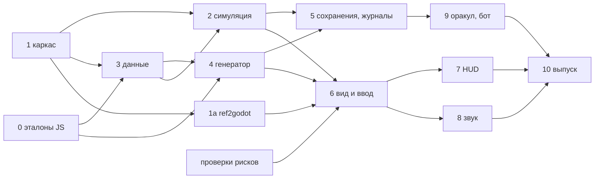

# План порта «The Elder Deep» на Godot 4.7 + C# (задача 2054): черновик

Дата: 15.11.2026. Черновик принят автором до вычитки: первый этап (каркас) начинается ночью, автор читает план утром. Вход: `study/port/architecture.md` (дальше «арх.», ссылки вида «арх. 3.3»), `study/port/requirements.md` («треб.»), `study/port/prototype.md`, `study/refactor2/summary.md`, `ROADMAP.md` (R-46, R-47, R-48), код прототипа `/Users/svsq/projects/elderdeep-godot/`. Решения автора из треб. 1 и 3 и из арх. 15 здесь применяются, а не обсуждаются. Кода порта в документе нет.

Как читать. Раздел 1 говорит, как идёт работа. Раздел 2 даёт все этапы одной таблицей. Раздел 3 это риски, которые автор проверяет днём на устройствах. Раздел 4 это каркас, расписанный задачами для агентов: по нему работают ночью. Раздел 5 описывает остальные этапы без разбивки на задачи. Раздел 6 это список для автора на утро. Приложение А это текст, который координатор вставляет в каждое задание агенту.

Термины: «автор» это владелец проекта; «модуль» это проект C# (один `.csproj`, одна `.dll`); «координатор» это главная сессия, которая раздаёт задания агентам и сама код не пишет; «порт» это репозиторий `elderdeep-godot`; «JS-версия» это репозиторий `game-demo`.

## 1. Как исполняется работа

### 1.1 Репозиторий порта

- Порт живёт в отдельном репозитории: локальный git в `/Users/svsq/projects/elderdeep-godot`. Удалённый репозиторий создаёт автор; агенты `git push` из репозитория порта не делают до его слова, только локальные коммиты.
- Состояние на 15.11.2026: репозиторий уже инициализирован автором, коммитов нет, часть файлов прототипа стоит в индексе, остальное в рабочем дереве, ветка называется `master`. `git init` агенты не выполняют.
- Первый коммит фиксирует прототип как есть (`prototype as measured`), второй переносит его в `prototype/` через `git mv` (задача S1-01). Дальше прототип служит справкой и стендом для проверок рисков (раздел 3); в решение порта он не входит и общих файлов сборки с ним нет. Решение автора 15.11.2026 (позже): прототип в git не хранится и из истории убран целиком; `prototype/` лежит на диске, закрыт строкой в `.gitignore`, первым коммитом репозитория стал каркас S1-01.
- Структура порта по арх. 2.1: `src/` (чистый C#), `game/` (проект Godot), `tests/`, `tools/`, `scripts/`, `prototype/`, `build/` (вне git).
- Ветка порта `main`. Пока удалённого репозитория и ревью нет, задачи каркаса коммитятся прямо в неё, по одной.

### 1.2 Трекер порта

- У порта свой трекер: `TASKS.md` (открытые ⏳ и частичные 🔁) и `TASKS_COMPLETED.md` (закрытые ✅) в корне порта, на русском, в том же стиле, что в JS-версии.
- Номер задачи: `S<этап>-<nn>`, например `S1-03`. Ряд номеров свой, с трекером `game-demo` не пересекается. Этап 1а пишется как `S1a-nn`, снятие эталонов с JS как `S0-nn` (раздел 5.0).
- В `game-demo` остаются только 2052–2056 как зонтик: 2055 закрывается, когда задачи всех этапов записаны в трекер порта, 2056 закрывается с выпуском порта.
- Новая задача берёт следующий номер своего этапа по обоим файлам трекера порта.
- Работа над задачей: заметка `→ ДД.ММ.ГГГГ: что сделано` дописывается к задаче; когда задача сделана целиком, она помечается ✅ и переносится (номер сохраняется) под тот же заголовок этапа в `TASKS_COMPLETED.md`.
- Находки по ходу работы (то, что не входит в задачу) записываются новой задачей в трекер порта, а не делаются сразу.

### 1.3 Правила для агента

1. **Одна задача, один коммит** (исключение: S1-01 с тремя коммитами). Сообщение коммита: одна строка по-английски вида `S1-03: core ids, rng, detmath`, без тела, без `Co-Authored-By` и других подписей. Правка трекера входит в тот же коммит.
2. **Ворота качества перед закрытием задачи.** Задача закрывается, только когда `scripts/check` завершился с кодом 0: сборка без предупреждений (предупреждения считаются ошибками), все тесты зелёные, анализаторы и проверка форматирования чистые. Если ворота красные, задача остаётся 🔁 с заметкой, что именно красное.
3. **По одной на рабочем дереве.** Задачи каркаса идут строго по очереди в одном рабочем дереве. Общие файлы (`ElderDeep.sln`, `Directory.Packages.props`, `TASKS.md`) каждая задача только дополняет своими строками.
4. **Ночной тихий режим.** С 23:00 до утра (агент сверяется с `date`) тяжёлые команды (`dotnet build`, `dotnet test`, запуск Godot, экспорт) идут по одной под `nice -n 20`, никогда две сразу. `scripts/check` делает это сам (S1-01).
5. **Политика моделей.** Решение автора 15.11.2026: тяжёлую работу (ядро симуляции, оракул детерминизма, горячие пути, генератор этажей) делает Fable 5.2; обычный код пишет Opus 5.5 на высоком усилии; механику и тесты делает Sonnet 5.5 (тесты на высоком усилии, чисто механические правки на низком); выбор записан у каждой задачи. Механические шаги по готовому рецепту (копирование арта, перенос файлов, прогон готовых скриптов) делает Sonnet 5.5 на низком усилии. Haiku не используется. Координатор передаёт `model` и `effort` в каждом запуске.
6. **Правила кода.** Каждое задание содержит правила кода из `CLAUDE.md` JS-версии («Engineering principles») и арх. 2.6 дословно по приложению А: понятные полные имена, без лишних комментариев, компактность, паттерны вместо «лапши», документация ссылается на код, в исходниках нет имён и номеров задач и нет ссылок на JS-версию.
7. **Критерий остановки.** Если нужного инструмента нет (SDK .NET, Godot, пакет NuGet, анализатор) или он не работает, агент не обходит ворота и не выключает правило. Он записывает причину заметкой `→` в трекер порта, оставляет задачу 🔁 или ⏳, коммитит только то, что проходит ворота, и останавливается. Координатор запускает следующую задачу, которая от остановленной не зависит (таблица в 4.2).
8. **Агент не проверяет свою работу ревью.** Его часть кончается на зелёных воротах и отчёте; ревью делает автор или отдельный агент по слову автора.
9. **Границы.** Агент не трогает `prototype/` (кроме S1-01 и чтения), не меняет репозиторий `game-demo`, не правит настройки доступа и не ставит программы в систему. Удаление папок только по буквальному пути.

### 1.4 Что стоит на машине (проверено 15.11.2026)

- .NET SDK 11.0.100, среда исполнения 11.0.0, в `/usr/local/share/dotnet`; команды `dotnet` в `PATH` нет, полный путь `/usr/local/share/dotnet/dotnet`.
- Godot 4.7.2 stable mono: `/Applications/Godot_mono.app/Contents/MacOS/Godot`; команды `godot` в `PATH` нет.
- Среды исполнения .NET 8 нет: библиотеки целятся в `net8.0` (арх. 2.5), а тесты и инструменты запускаются на среде 11 через свойство `RollForward`.
- Пакеты NuGet (среда тестов, анализаторы) качаются из сети при первой сборке. Нет сети: срабатывает критерий остановки.

## 2. Этапы порта

Нумерация этапов задана автором и отличается от заготовки арх. 16; соответствие в последнем столбце.

| Этап | Что | После чего | Готово, когда (одна проверяемая строка) | Арх. 16 |
|---|---|---|---|---|
| 0 | снятие эталонов и данных с JS (`S0-nn`), по мере нужды этапов | слово автора на каждый запуск | каждая строка таблицы арх. 11.3 лежит файлом в `tests/golden/` или `game/` порта | 0 |
| 1 | каркас | нет | `scripts/check` зелёный на чистом клоне, Godot без окна стартует и шагает пустую симуляцию | 1 |
| 1а | навык `ref2godot` (R-48) | S1-10 (нужен проект Godot); идёт параллельно с 2 | навык из корня порта выдаёт арт в `game/art/`, собирает атлас на тип и снимает кадр PNG из Godot | 1а |
| 2 | ядро симуляции: шаг, состояние, шина, команды, ГСЧ, затем системы по доменам | 1; системы после 3 | сценарии доменов зелёные, 1000 шагов без выделений, шаг в бюджете | 3 |
| 3 | данные: экспорт из JS и загрузчик | 1, S0 (экспорт) | все таблицы загружены и проверены, формулы `Balance` сошлись с сеткой JS | 2 |
| 4 | генератор этажей и шаблон города | 1, 3, S0 (дампы) | структура и статистика на сидах 1–40 в полосах JS по всем режимам, город из шаблона совпал с JS по позициям | 4 |
| 5 | сохранения и журналы, боевая версия | 2, 4 | круг «сохранить, загрузить, сравнить» на каждый режим, подмена отвергается, оборванный журнал читается | 5 |
| 6 | вид и ввод: риги, атласы, свет, туман, Y-сортировка, пиксельная сетка | 2, 4, 1а, проверки рисков 1, 3, 4 | первый биом играется от входа до лестницы с клавиатуры и мыши, вызовы отрисовки в бюджете | 7, 10 |
| 7 | HUD, экраны, тексты | 6 | все экраны карты экранов открываются, обход фокуса и раскладка проходят проверки, `ru`, `en`, `uk` без пропусков | 8, 11 |
| 8 | звук и музыка: банк и заглушки | 6, S0 (банк) | у каждого события со звуком есть ключ и файл, шины и переходы музыки проходят тесты | 9 |
| 9 | тесты и оракул, бот на C# | 2–5 | трассы JS сходятся с допуском, доли побед и смертей бота в полосах эталона JS | 6 |
| 10 | платформы и выпуск: десктоп, затем геймпад и Deck, затем мобильные (R-47) | 6–9 | release-сборки Windows, macOS и Linux проходят кампанию; затем Deck в бюджете; затем R-47 | 12, 13, R-47 |

Тесты пишутся в каждом этапе вместе с кодом; этап 9 это не «начало тестов», а полная сверка с оракулом и бот. Подробности этапов 2–10 в разделе 5.



## 3. Проверки рисков (запускает автор днём)

В ночную работу не входят: нужны устройства, глаза автора и сборка под iOS. Это риски 1–4 из арх. 14. От ответа зависит устройство вида или сборки, поэтому ответы нужны до этапа 6, а риск 2 до того, как на генераторе списков вырастет много кода (до конца этапа 2). Профиль подписи iPad живёт до 21.11.2026, после этого сборку под iPad надо выпускать заново.

Стенд: сцена замеров прототипа в `prototype/` (ключи `--auto`, `--stress`, `--only --stage=N`, результат в `bench.txt`, брать только замеры с `drawn=100 %` и не с первого запуска после установки). Правки стенда под проверки это отдельные задачи `S0-nn` по слову автора; исполнитель Opus 5.5 на высоком усилии.

| № | Риск | Что собрать | Что измерить | Как читать ответ | Что меняется в плане |
|---|---|---|---|---|---|
| Р1 | склейка частей атласа при Y-сортировке | части скелета, героя и ещё одного типа монстра в атласах «один на тип»; 200 врагов трёх типов вперемешку | вызовы отрисовки и `script + cpuRender` на iPad 6 и Pixel 7 против 2460 вызовов из prototype ш.2 | в бюджете: не больше 1250 вызовов на кадр; провал: больше 2500 | провал: один общий атлас на биом или спрайт без рига для дальней толпы (арх. 7.7); этап 6 начинается с этого решения |
| Р2 | регистрация без рефлексии и JSON на NativeAOT | после S1-06 и S1-10: проект `game/` со сгенерированным списком и загрузкой одного файла данных, экспорт под iOS | приложение стартует на iPad 6 и пишет в файл в `Documents` число записей реестра и загруженных файлов | числа совпали с десктопом | провал генератора кода: запасной шаг сборки по именам файлов (арх. 2.5); провал JSON: ручной разбор через `Utf8JsonReader` |
| Р3 | швы обводки | три варианта на одном риге: шейдер на каждой части, `CanvasGroup` на героя и цель, подложка-силуэт | кадры рядом с JS-версией, вызовы отрисовки каждого варианта, рвёт ли пачку параметр на актёра | выбирает автор глазами; цена варианта не выводит кадр из бюджета | выбранный вариант записывается в арх. 7.4 до задач обводки этапа 6 |
| Р4 | предел `PointLight2D` на Compatibility | 30, 45 и 60 источников разного радиуса в комнате стенда | сколько источников реально светит на один элемент, `cpuRender`, вызовы отрисовки | найден предел на элемент и на кадр | число «настоящих» источников идёт в таблицу стиля света, остальные рисуются светящимися спрайтами (арх. 7.5) |

Заодно, если устройства на руках: пустая сборка каркаса стартует на Pixel 7 и iPad 6 (часть критерия этапа 1 из арх. 16, вынесена сюда, потому что ночью устройств нет); `AesGcm.IsSupported` на iOS и Android (риск 14); совпадение векторов `DetMath` и ГСЧ на Mac, Android и iOS (риск 8).

## 4. Этап 1 «Каркас»: задачи для агентов

Цель этапа: решение, в которое дальше только добавляют файлы. Игровой логики и контента в каркасе нет. Критерий готовности этапа: на чистом клоне `scripts/check --godot` завершается с кодом 0.

### 4.1 Общее для всех задач этапа

- Рабочая папка `/Users/svsq/projects/elderdeep-godot`. Команды: `/usr/local/share/dotnet/dotnet`, `/Applications/Godot_mono.app/Contents/MacOS/Godot`.
- Приёмка каждой задачи включает `scripts/check` с кодом 0 (после S1-01) и запись в трекере порта.
- Среда тестов xUnit. Имена тестов говорят, что проверяется. У каждого поведения есть тест.
- Чистые модули целятся в `net8.0`, помечены `IsAotCompatible` (предупреждения совместимости с NativeAOT считаются ошибками), не ссылаются на `Godot.*`.
- В задаче нельзя: добавлять игровую логику и контент; заводить типы «на будущее», которые сейчас никто не использует; отключать правило анализатора без записи причины рядом с правилом; писать в исходниках номера задач и упоминать JS-версию.
- Оценка времени дана для одного агента ночью, вместе со сборками под `nice`.

### 4.2 Порядок запуска и зависимости

Запуск по одной, в порядке номеров. Вся очередь оценивается в 10–13 часов, за одну ночь она целиком не пройдёт: то, что не успело, идёт днём в том же порядке.

| Задача | Что | Зависит от | Модель, усилие | Оценка |
|---|---|---|---|---|
| S1-01 | репозиторий, решение, модули, правила ссылок | нет | Sonnet 5.5, высокое | 60–90 мин |
| S1-02 | ворота качества: анализаторы, метрики, формат | S1-01 | Sonnet 5.5, высокое | 45–75 мин |
| S1-03 | Core: идентификаторы, `DetMath`, ГСЧ, сид | S1-02 | Opus 5.5, среднее | 90–120 мин |
| S1-04 | события, команды, интерфейсы | S1-03 | Opus 5.5, среднее | 60–90 мин |
| S1-05 | каркас симуляции: шаг, состояние, конвейер | S1-04 | Opus 5.5, среднее | 60–90 мин |
| S1-06 | данные: загрузчик JSON и генерируемый реестр | S1-03 | Opus 5.5, среднее | 90–120 мин |
| S1-07 | журналы | S1-03 | Opus 5.5, среднее | 60–90 мин |
| S1-08 | сохранения | S1-05 | Opus 5.5, среднее | 60–90 мин |
| S1-09 | локализация | S1-02 | Sonnet 5.5, высокое | 45–60 мин |
| S1-10 | проект Godot `game/` | S1-05; для полной приёмки S1-06, S1-07, S1-09 | Opus 5.5, среднее | 90–120 мин |
| S1-11 | документация каркаса и итог пилота ворот | все | Sonnet 5.5, высокое | 45–60 мин |

Что делать при остановке:

- Остановилась S1-01 или S1-02 (нет SDK, нет сети для пакетов): очередь останавливается целиком, это основание всего остального.
- Остановилась S1-03: дальше идёт только S1-09.
- Остановилась S1-04 или S1-05: идут S1-06, S1-07, S1-09; S1-08 и S1-10 ждут.
- Остановилась S1-06, S1-07, S1-08 или S1-09: остальные идут; S1-10 делается без недостающей части и остаётся 🔁.
- Остановилась S1-10 (Godot не запускается без окна): остальные идут, S1-11 описывает то, что есть.

### S1-01. Репозиторий и решение

**Цель.** Пустое, но собираемое решение со структурой арх. 2.1, в котором запрещённая ссылка между модулями ломает тест.

**Файлы.** `prototype/**` (перенос), `.gitignore`, `.gitattributes`, `.editorconfig` (основа: кодировка, отступы, концы строк), `global.json`, `Directory.Build.props`, `Directory.Packages.props`, `ElderDeep.sln`, `src/ElderDeep.{Core,Map,Data,Gen,Sim,Save,Logging,Presentation,Bot}/`, `tests/ElderDeep.Tests.{Core,Sim,Data,Logging,Save,Locale,Architecture}/`, `scripts/check`, `TASKS.md`, `TASKS_COMPLETED.md`.

**Что сделать.**
1. `git init` не выполнять: репозиторий уже есть. Переименовать ветку: `git branch -m main`. Проверить, что `.gitignore` закрывает `build/`, `.godot/` и `/android/`; затем `git add -A` и посмотреть размеры того, что попало в индекс: бинарные файлы крупнее нескольких МБ (сборки, архивы, шаблоны экспорта) в коммит не идут, они дописываются в `.gitignore`, а их список записывается заметкой `→` в трекере. Первый коммит фиксирует прототип как есть: `prototype as measured`.
1а. Второй коммит: перенос прототипа в `prototype/` через `git mv` (все отслеживаемые файлы корня); папки вне git (`build/`, `.godot/`) переносятся туда же обычным перемещением по буквальным путям, чтобы команды автора из `prototype.md` находили сборки. В `prototype/` положить пустой `Directory.Build.props`, чтобы правила решения на прототип не действовали. Сообщение: `S1-01: move prototype into prototype/`. Каркас идёт третьим коммитом поверх; это единственная задача с тремя коммитами.
2. `global.json`: SDK 11.0.100, `rollForward: latestFeature`. `.gitignore`: `bin/`, `obj/`, `.godot/`, `build/`, `*.user`, `/android/`, `TestResults/`.
3. `Directory.Build.props`: `Nullable=enable`, `TreatWarningsAsErrors=true`, `LangVersion` зафиксирован, `AnalysisLevel` зафиксирован, `ImplicitUsings` по выбору агента одинаково везде. Версии пакетов в `Directory.Packages.props` (одно место на всё решение).
4. Девять модулей-пустышек: `net8.0`, `IsAotCompatible=true`, ссылки проектов строго по таблице арх. 2.2 (Core ни на что; Map, Data, Logging на Core; Gen на Core, Map, Data; Sim на Core, Map, Data; Save на Sim; Presentation на Sim, Data; Bot на Sim). В пустом модуле нет классов-заглушек: достаточно проекта.
5. Тестовые проекты на xUnit, `net8.0` с `RollForward=LatestMajor`. Тесты для Map, Gen, Presentation и Bot заводятся в своих этапах.
6. Архитектурный тест в `ElderDeep.Tests.Architecture`: читает `.csproj` модулей и сверяет ссылки с таблицей разрешённых (таблица одна, данными в тесте); отдельно проверяет, что ни один модуль из `src/` не ссылается на пакеты и SDK Godot.
7. `scripts/check`: находит `dotnet` (в `PATH` или `/usr/local/share/dotnet/dotnet`), затем сборка решения, `dotnet test`, `dotnet format --verify-no-changes`; ночью (по `date`, с 23:00 до 08:00) каждая команда под `nice -n 20`; код выхода ненулевой при любой неудаче; в конце одна строка итога.
8. Трекер порта: в `TASKS.md` раздел «Этап 1. Каркас» с задачами S1-01…S1-11 (текст: цель и приёмка из этого плана, кратко), `TASKS_COMPLETED.md` с теми же заголовками.

**Приёмка.** `git log --oneline` показывает три коммита: `prototype as measured`, перенос, каркас; ветка `main`; в истории нет файлов крупнее нескольких МБ, исключённое перечислено в трекере; `scripts/check` выходит с кодом 0; временно добавленная ссылка `ElderDeep.Core → ElderDeep.Sim` роняет архитектурный тест с названием обоих модулей (проверить и откатить, в коммит не входит); `git status` чистый.

**Не делать.** Не править код прототипа; не добавлять `game/` (это S1-10); не создавать удалённый репозиторий; не настраивать CI.

### S1-02. Ворота качества

**Цель.** Размер, сложность и стиль кода проверяет сборка, а не глаз (арх. 2.6). Ворота включены до первого кода, чтобы каждая следующая задача писалась под ними.

**Файлы.** `Directory.Build.props`, `.editorconfig`, `CodeMetricsConfig.txt`, `Directory.Packages.props`, `tests/ElderDeep.Tests.Architecture/` (тест строк и файл исключений).

**Что сделать.**
1. Включить `AnalysisMode=Recommended`, `EnforceCodeStyleInBuild=true`; в `.editorconfig` включить CA1501, CA1502, CA1505, CA1506 с серьёзностью `warning` (сборка превращает её в ошибку).
2. `CodeMetricsConfig.txt` подключить через `AdditionalFiles`; пороги из арх. 2.6: цикломатическая сложность метода 10, индекс сопровождаемости 20, связность типа 40 и метода 20. Синтаксис файла сверить с документацией Microsoft.
3. Подключить `SonarAnalyzer.CSharp`: S138 (метод до 40 строк), S104 (файл до 300 строк), S3776 (когнитивная сложность 15), S107 (число параметров). Способ задать пороги (файл `SonarLint.xml` в `AdditionalFiles` или `.editorconfig`) выяснить на месте. Если пороги задать не удалось за разумное время, Sonar не подключать, записать причину заметкой; длину закрывает тест строк.
4. Тест строк в `ElderDeep.Tests.Architecture`: каждый `.cs` под `src/` и `game/` не длиннее 300 строк; сгенерированные файлы пропускаются; исключения лежат файлом рядом, у каждого записана причина.
5. Запрет `Dictionary` и `HashSet` в состоянии и запрет `Math.Sin` и подобных в симуляции (арх. 3.2, 3.9) подключить через `BannedApiAnalyzers` с файлом запретов для модулей `Sim`, `Gen`, `Map`; если пакет не ставится, записать задачей этапа 2.
6. Roslynator не подключать (решение отложено до итога пилота в S1-11).

**Приёмка.** `scripts/check` с кодом 0 на пустом решении. Каждое правило проверено намеренно плохим образцом, который не коммитится: метод со сложностью 11, метод длиннее 40 строк, файл длиннее 300 строк, неотформатированный файл; каждый раз `scripts/check` падает с именем правила. Результат четырёх проб записан заметкой `→` в трекере.

**Не делать.** Не поднимать пороги; не ставить глобальные инструменты в систему; не включать правила стиля, требующие XML-комментариев к каждому члену.

### S1-03. Core: идентификаторы, `DetMath`, ГСЧ, сид

**Цель.** Основание детерминизма (арх. 3.3, 3.9) с замороженными тестовыми векторами.

**Файлы.** `src/ElderDeep.Core/Ids/`, `Numerics/`, `Random/`; `tests/ElderDeep.Tests.Core/`; `tests/golden/rng/`, `tests/golden/detmath/`.

**Что сделать.**
1. Сильные идентификаторы: один способ объявить типизированный номер (`EnemyId`, `DoorId` и так далее появятся позже; сейчас механизм и один-два типа, которые нужны S1-04) и типизированный строковый `Id` для открытых множеств; сравнение, вывод в строку, запрет смешать два разных типа проверяет компилятор.
2. `Seed128`: 128 бит; вывод строкой hex из 32 символов; разбор полного hex, короткого hex до 16 символов и десятичного числа; короткое значение расширяется через `splitmix64`; первые 8 символов для имени файла журнала.
3. `SplitMix64` и `Xoshiro256StarStar`: только 64-битные операции, без `UInt128`. Методы броска построены на одном источнике: дробное в `[0, 1)`, целое в диапазоне, `Chance`, `Pick`, `WeightedPick`, `Shuffle`, `Skip`. Состояние копируется и сравнивается (оно войдёт в сохранение).
4. Потоки: `seedПотока = Hash(главныйСид, имяПотока)` на целых числах, без `string.GetHashCode()`; для этажа в хеш входят номер этажа и номер попытки. Таблица `RngStreams`: имя, назначение, счётчик бросков; пока в ней только потоки, нужные тестам каркаса.
5. `DetMath`: `Sin`, `Cos`, `Atan2`, `Exp`, `Log`, `Pow` на чистом C# без вызовов `Math.Sin` и подобных (сложение, умножение, деление и `Math.Sqrt` разрешены). Точность против `System.Math` не хуже 1e-12 на сетке входов; сетка и результаты заморожены файлом в `tests/golden/detmath/` (побитовое сравнение с файлом, чтобы любая платформа давала те же биты).
6. Тестовые векторы ГСЧ: взять опубликованные авторами эталонные реализации на C (`splitmix64.c`, `xoshiro256starstar.c`, сайт `prng.di.unimi.it`), собрать локально `cc`, снять по 100 чисел на несколько сидов, положить в `tests/golden/rng/` вместе с `README.md` о происхождении и с исходниками эталона. Быстрая перекрёстная проверка: `splitmix64` от сида 1234567 начинается с 6457827717110365317, 3203168211198807973 (числа записаны по памяти, верным считается эталон). Отдельные замороженные векторы: расширение короткого сида и вывод потоков по имени.

**Приёмка.** `dotnet test tests/ElderDeep.Tests.Core` зелёный; векторы `xoshiro256**` и `splitmix64` совпали с эталонными файлами; `Seed128` проходит круг «в строку и обратно» на случайных значениях; два потока с разными именами от одного сида дают разные последовательности, один и тот же поток от одного сида одинаковые; `scripts/check` с кодом 0.

**Не делать.** Не добавлять `mulberry32` (он тестовый источник этапа 9); не писать `Vec2`, `OrderedSet`, `JsRound` и кольцевые буферы «заодно» (кольцевой буфер нужен S1-04 и делается там, остальное в этапе 2); не сочинять векторы самому: если эталон скачать и собрать не удалось, векторы помечаются непроверенными, задача остаётся 🔁.

### S1-04. События, команды и интерфейсы

**Цель.** Два входа и два выхода симуляции по арх. 3.5, 3.6, 3.8, пока без игровых событий.

**Файлы.** `src/ElderDeep.Sim/Kernel/` (подпапки `Signals/`, `ViewEvents/`, `Commands/`, `Input/`, `Views/`); `src/ElderDeep.Core/Collections/` (кольцевой буфер); `tests/ElderDeep.Tests.Sim/Kernel/`.

**Что сделать.**
1. Шина сигналов: синхронная доставка внутри шага; у подписчика явный номер очереди; порядок вызова определяется номером, а не порядком подписки; два подписчика с одним номером на один сигнал это ошибка при сборке шины. Контекст сигнала несёт явные поля «глубина цепочки» и «источник герой» (арх. 3.4).
2. Поток событий вида: кольцевой буфер структур фиксированного размера (вид события, время шага, `Id` сущности, позиция, несколько числовых параметров, постоянный `Id` события); читатели с собственным курсором; переполнение не ломает игру, читатель узнаёт число пропущенных; запись и чтение без выделений.
3. Реестр видов событий: имя вида и схема параметров (имя, тип); пока пустой, механизм проверен тестовым видом события в тестах.
4. `InputFrame`: структура намерений шага (направление, мировая точка прицела, набор действий, слот, взаимодействие), без пикселей и кодов клавиш.
5. Команды: интерфейс команды, обработчик команды, результат с кодом отказа; очередь команд, исполняемая в начале следующего шага в порядке поступления. `IGameCommands`: отправить команду, подать `InputFrame`.
6. `IWorldView`: только то, что уже существует (номер шага, доля шага, курсор потока событий, версии); `IBotView` как урезанный вид. Чтение ничего не пишет.

**Приёмка.** Тесты: порядок подписчиков не зависит от порядка подписки; дубль номера очереди отвергается; событие читается по `Id` двумя независимыми читателями; переполнение буфера даёт счётчик пропусков; 10 000 публикаций события и чтений не выделяют память (`GC.GetAllocatedBytesForCurrentThread`); команды исполняются в порядке поступления и только в начале следующего шага; отказ команды возвращает код. `scripts/check` с кодом 0.

**Не делать.** Не заводить игровые сигналы (`Hit`, `Kill`) и события до этапа 2; не писать общий `switch` по типу команды; не добавлять в `IWorldView` методы под будущий контент.

### S1-05. Каркас симуляции

**Цель.** Симуляция шагает 120 раз в секунду с пустым состоянием, порядок систем записан таблицей (арх. 3.1, 3.2, 3.7).

**Файлы.** `src/ElderDeep.Sim/Step/`, `State/`, `Systems/` (только интерфейс системы и таблица порядка); `tests/ElderDeep.Tests.Sim/Step/`, `State/`.

**Что сделать.**
1. `FixedStepAccumulator`: копит прошедшее время и отдаёт число шагов; частота 120 Гц и предел шагов за кадр это именованные настройки цикла; остаток отдаётся как доля шага для `IWorldView`. Чистый C#, им пользуется узел-мост Godot (S1-10), тесты и бот.
2. Состояние: типизированное дерево по арх. 3.2 в объёме каркаса: `RunProfile`, `RunState` (номер шага, потоки ГСЧ), корень состояния; без ссылок на сервисы и делегатов. `MetaState`, `Settings`, `FloorLayout` и `FloorState` появляются в своих этапах. Значение «никогда» для времени одно (`Never`).
3. `Simulation.Step(InputFrame)`: команды из очереди, затем системы по таблице порядка (шаблон Стратегия: система это класс с одним методом и явным контекстом шага). Таблица порядка одна, в одном файле; пока в ней нет игровых систем.
4. Реестр обработчиков команд: ключ команды, обработчик; регистрация явным списком в одном месте сборки симуляции. Переход на сгенерированный список это задача этапа 2 (после S1-06).
5. Контрольный хеш состояния: обход состояния без выделений (сейчас номер шага и состояния потоков ГСЧ); им пользуются тест детерминизма и журнал.

**Приёмка.** Тесты: накопитель при 1/60 с отдаёт 2 шага, при заминке отдаёт не больше предела; 1000 шагов без событий не выделяют память и не добавляют сборок мусора; два прогона с одним сидом и одним вводом дают одинаковые контрольные хеши, с разными сидами разные; система, добавленная в таблицу в тесте, вызывается в записанном порядке; команда, поданная на шаге N, исполнена на шаге N+1. `scripts/check` с кодом 0.

**Не делать.** Не писать системы героя, врагов и мира; не использовать физический тик Godot и вообще Godot; не заводить глобальное состояние и статические изменяемые поля.

### S1-06. Данные: загрузчик JSON и генерируемый реестр

**Цель.** Загрузка данных и регистрация кода без рефлексии, пригодные для NativeAOT (арх. 2.5, 4.2, 4.4).

**Файлы.** `src/ElderDeep.Data/Loading/`, `Validation/`; `src/ElderDeep.Generators/` (новый проект, генератор исходного кода); `tests/ElderDeep.Tests.Data/` (с фикстурами); `ElderDeep.sln`.

**Что сделать.**
1. Источник файлов данных за интерфейсом (в тестах папка на диске, в игре пакет ресурсов Godot, адаптер в S1-10).
2. Разбор JSON только через сгенерированный контекст `System.Text.Json`; сериализация через рефлексию выключена свойством проекта, чтобы её случайное использование ломало сборку.
3. Загрузка в два прохода: разбор в типизированные записи, затем проверка (уникальность `Id`, целость ссылок по `Id`). Ошибка называет файл и поле и останавливает загрузку; тихих подмен нет.
4. Первая настоящая таблица: версия данных `data/version.json` (арх. 4.5). Каталог «одна сущность на файл» проверяется фикстурой в тестах.
5. `ElderDeep.Generators`: инкрементный генератор, который находит классы с атрибутом-меткой и пишет таблицу «ключ → создатель»; фабрика создаёт обработчик по ключу без `Activator` и без поиска типов во время работы. Генератор не знает о конкретных реестрах: метка и интерфейс задаются параметрами.
6. Демонстрация живёт только в тестах: в `ElderDeep.Tests.Data` есть реестр с двумя записями, каждая в своём файле; тест читает сгенерированную таблицу. В боевых модулях демонстрационных классов нет.

**Приёмка.** Тесты: файл данных с дублем `Id`, с битой ссылкой и с неизвестным полем отвергается с именем файла и поля; новая запись реестра, добавленная одним новым файлом в фикстуры, появляется в таблице без правки других файлов (проверяется тестом, который считает записи по файлам каталога); два ключа с одним именем ломают сборку с понятным сообщением генератора. `scripts/check` с кодом 0, предупреждений совместимости с NativeAOT нет.

**Не делать.** Не экспортировать данные из JS-версии (этап 3, S0); не писать схемы врагов, предметов и сил; не использовать рефлексию даже в запасном пути. Проверка на iPad это Р2 (раздел 3), не часть задачи.

### S1-07. Журналы

**Цель.** Журнал забега и журнал движка пишутся в фоне и переживают вылет (арх. 6.2–6.4).

**Файлы.** `src/ElderDeep.Logging/` (`BackgroundWriter`, журнал забега, журнал движка, читатель); `tests/ElderDeep.Tests.Logging/`.

**Что сделать.**
1. `BackgroundWriter`: очередь фиксированного размера без блокировок; игровой поток кладёт запись без выделений; отдельный поток пишет пачками; принудительный сброс по вызову; переполнение очереди или отказ диска пропускают запись, считают пропуски и один раз поднимают признак предупреждения, игру не останавливают.
2. Журнал забега: JSON Lines, один забег это один файл `run-<дата>-<время>-seed<8 символов>.jsonl`; виды записей каркаса: заголовок (версии формата, сборки, данных, полный сид, профиль), ввод (только при изменении, с номером шага), команда, событие, контрольный хеш, ошибка, итог. Период контрольного хеша это настройка журнала. Запись строится без рефлексии.
3. Журнал движка: отдельный текстовый файл на сеанс в `logs/engine/`; из путей вырезаются имя пользователя и домашняя папка. Источники строк (вывод Godot, исключения) подключает S1-10.
4. Настройка: при выключенном флаге «Сохранять журналы забега» файл забега не создаётся и подписчик не создаётся; журнал движка в этом режиме пишет только критические ошибки.
5. Читатель журнала: читает файл до последней целой строки, оборванную последнюю строку пропускает и сообщает об этом.
6. Пути приходят параметром (интерфейс `IPlatformPaths` появится в слое Platform); время для имени файла приходит параметром, в модуле нет обращения к системным часам в горячем пути.

**Приёмка.** Тесты: файл, обрезанный посередине записи, читается до последней целой строки; выключенная настройка не создаёт файлов; отказ записи (каталог только для чтения или источник-заглушка) не бросает исключение в игровой поток и ставит признак предупреждения; 10 000 постановок записи в очередь не выделяют память в вызывающем потоке; после сброса все поставленные записи лежат в файле в порядке постановки. `scripts/check` с кодом 0.

**Не делать.** Не шифровать журналы; не делать воспроизведение забега по журналу; не ставить лимит объёма; не писать экран настроек.

### S1-08. Сохранения

**Цель.** Защищённый формат сохранения с версией и атомарной записью (арх. 6.1) на состоянии каркаса.

**Файлы.** `src/ElderDeep.Save/` (формат, шифры, хранилище, миграции); `tools/SaveDump/` (консольная программа автора); `tests/ElderDeep.Tests.Save/`; `ElderDeep.sln`.

**Что сделать.**
1. Формат файла: открытый заголовок (отметка формата, версия формата, признак схемы защиты, `nonce`) и зашифрованное тело; внутри тела JSON с заголовком (версия формата, версия данных, версия сборки, сид, режим) и состоянием; сериализация сгенерированным кодом.
2. Защита стратегией: основная схема AES-GCM (тег 16 байт задан явно, заголовок входит в проверку как связанные данные); запасная AES-CBC и HMAC-SHA256 по схеме «зашифровать, потом подписать», берётся, когда `AesGcm.IsSupported` ложно. Обе покрыты тестами.
3. Ключ приходит через интерфейс поставщика ключа. В каркасе есть только поставщик для тестов и сборок разработчика; схему хранения ключа в игре решает автор (арх. 15, открытый вопрос 1).
4. Отказы различаются кодами: файл повреждён или изменён; версия формата новее сборки; версия данных новее сборки. Файл при отказе не удаляется.
5. Атомарная запись: временный файл рядом, затем переименование поверх; предыдущий файл остаётся запасным до успешной записи следующего; чтение умеет предложить запасной файл.
6. Миграции: шаг «версия N → N+1» это отдельный файл, вызывается только при загрузке; в каркасе версия 1 и пустой список шагов, механизм проверен тестовым шагом в тестах.
7. `tools/SaveDump`: расшифровывает файл в читаемый JSON тем же кодом модуля; в игру не входит.
8. Запись в каркасе синхронная функция; постановку в фоновый писатель и копию состояния на границе шага делает этап 5.

**Приёмка.** Тесты: круг «сохранить, загрузить» возвращает состояние с тем же контрольным хешем; изменённый байт в теле и изменённый байт в заголовке дают отказ «повреждён или изменён»; усечённый файл читается как повреждённый; версия новее даёт свой код отказа; оборванная запись (остался временный файл) не портит слот; `SaveDump` выдаёт тот же JSON, что был записан; обе схемы защиты проходят один набор тестов. `scripts/check` с кодом 0.

**Не делать.** Не зашивать ключ в исходники; не читать сохранения JS-версии; не шифровать настройки; не добавлять слоты и экран загрузки.

### S1-09. Локализация

**Цель.** Контракт текста и проверка согласованности переводов до появления первого игрового текста (арх. 10).

**Файлы.** `src/ElderDeep.Presentation/Text/`; `game/locale/ru/ui.po`, `game/locale/en/ui.po`, `game/locale/uk/ui.po`; `tests/ElderDeep.Tests.Locale/`.

**Что сделать.**
1. Контракт: ссылка на текст (ключ, именованные параметры, число для множественной формы). Чистый C# отдаёт ссылку, строку из неё делает слой UI; готовых строк в моделях и состоянии нет.
2. Пример: по одному файлу темы `ui` на язык с несколькими настоящими строками каркаса (название игры, подписи отладочного слоя), одна строка с множественным числом (три формы у `ru` и `uk`), одна с тегом `[kw]` и именованным плейсхолдером. Ключи начинаются с темы.
3. Проверка в `ElderDeep.Tests.Locale`: читатель PO (нужен только тестам, игра читает PO средствами Godot) и правила: у каждого ключа русского файла есть перевод в `en` и `uk` (пропуск считается и печатается); набор тегов разметки перевода совпадает с русской строкой; набор плейсхолдеров совпадает; число форм множественного числа соответствует заголовку файла; ключ уникален в пределах языка; тема стоит в начале ключа и совпадает с именем файла.
4. Набор известных тегов (`kw`, `item`, `place`) это одна таблица данных, которую читают и тест, и позже ресурс стиля.

**Приёмка.** Тесты зелёные на примере; каждое правило проверено испорченной фикстурой в тестах (лишний тег, потерянный плейсхолдер, пропавший ключ, лишняя форма); новая тема добавляется новым файлом без правки теста. `scripts/check` с кодом 0.

**Не делать.** Не переносить тексты из JS-версии (S0 и этап 7); не писать подстановку глифов и вырезание тегов (слой UI, этап 7); не добавлять десятый модуль под PO.

### S1-10. Проект Godot `game/`

**Цель.** Игра запускается, узел-мост шагает симуляцию, счётчики видны; всё, что есть в каркасе, подключено.

**Файлы.** `game/project.godot`, `game/ElderDeep.Game.csproj`, `game/export_presets.cfg`, `game/Loop/` (узел-мост), `game/Debug/` (отладочный слой), `game/Platform/` (адаптеры источника данных и путей), `game/Main.tscn`, `game/data/version.json`, `ElderDeep.sln`, `scripts/check`.

**Что сделать.**
1. Проект: Godot 4.7.2, рендерер Compatibility для всех платформ, базовый размер 1920×1080, растяжение `canvas_items` и `expand`, сжатие текстур ETC2/ASTC и S3TC/BPTC, мипкарты по умолчанию, фильтр экспорта включает `data/**`. Решение одно в корне: каталог решения для Godot указать настройкой проекта (проверить имя настройки в 4.7). `ElderDeep.Game` ссылается на чистые модули, кроме `Bot`.
2. Дерево сцены по арх. 7.1 в объёме каркаса: корень, `WorldFrame` (фильтр «ближайший сосед») с `WorldViewport` 960×540, слой `Debug`. Остальные слои добавляются в этапе 6.
3. Узел-мост: единственный корень сборки. Создаёт симуляцию, каждый кадр отдаёт прошедшее время в `FixedStepAccumulator`, вызывает шаги, читает поток событий, подаёт пустой `InputFrame`. Игровых решений в узле нет.
4. Отладочный слой: FPS, время кадра, число шагов симуляции за кадр, вызовы отрисовки (`RenderingServer.GetRenderingInfo`); подписи берутся из `ui.po` (если S1-09 сделана).
5. Подключить: загрузку `data/version.json` через адаптер источника данных (S1-06); журнал движка и журнал забега через адаптер путей в пользовательскую папку Godot, со сбросом при выходе (S1-07).
6. Из прототипа взять только то, что ложится на архитектуру: настройки `project.godot`, пресеты экспорта, способ чтения счётчиков. `Main.cs`, `RigData.cs` и сцена замеров не переносятся; `Rig.cs` и метод замера ждут этапа 6 и остаются в `prototype/`.
7. Ключ командной строки для проверки без окна: игра делает заданное число кадров, пишет в стандартный вывод одну строку итога (число шагов симуляции, версия данных, число записей в журнале) и завершается.
8. `scripts/check --godot`: собирает `game/` и запускает Godot без окна (`--headless --path game --quit-after <кадры>`), сверяет строку итога; без ключа `--godot` скрипт ведёт себя по-прежнему.

**Приёмка.** `scripts/check --godot` с кодом 0; строка итога показывает ненулевое число шагов и версию данных из файла; в папке журналов появился файл забега с заголовком и файл движка; сборка `game/` без предупреждений под теми же воротами.

**Не делать.** Не переносить риги, свет, туман и арт; не делать экспорт на устройства (раздел 3); не писать ввод (этап 6) и экраны (этап 7); не класть логику в узлы.

### S1-11. Документация каркаса и итог пилота ворот

**Цель.** Новый человек или агент понимает по `README`, что где лежит; пороги метрик проверены на настоящем коде каркаса.

**Файлы.** `README.md` в корне; `README.md` в каждой папке `src/ElderDeep.*`, в `game/`, `tests/`, `tools/`, `scripts/`; `docs/quality-gates.md`; `TASKS.md` (находки).

**Что сделать.**
1. Корневой `README.md`: что это за проект, как собрать и проверить (`scripts/check`, `scripts/check --godot`), схема модулей и направление ссылок, где лежат данные, тексты, эталоны.
2. `README.md` модуля: что это за модуль, что в нём лежит, от чего он зависит, как добавить новое (файлом или записью). Только имена классов, файлов и папок, которые находятся поиском; без имён и номеров задач, без упоминаний JS-версии.
3. `docs/quality-gates.md`: какие правила включены, их пороги, чем каждое проверяется, как записать исключение.
4. Итог пилота (заметкой в трекере и в отчёте): сколько раз код каркаса упирался в каждый порог, какие исключения записаны, предложение по Roslynator и по порогам. Сами пороги без слова автора не менять.
5. Сверить на чистом клоне (`git clone` локального репозитория во временную папку): `scripts/check --godot` с кодом 0.

**Приёмка.** В каждой папке модуля есть `README.md`; поиск по `src/`, `game/`, `tests/`, `tools/` не находит номеров задач (`S\d+-\d+`) и слов о JS-версии в исходниках; проверка на чистом клоне прошла. `scripts/check --godot` с кодом 0.

**Не делать.** Не писать документацию наперёд о том, чего в коде нет; не дублировать `architecture.md`; не делать ревью кода других задач.

## 5. Этапы 2–10 (без разбивки на задачи)

Разбивка на задачи `S<этап>-<nn>` делается, когда этап подходит (зонтик 2055). Исполнитель: тяжёлое Fable 5.2, обычный код Opus 5.5 на высоком усилии, механика и тесты Sonnet 5.5 (тесты на высоком, механика на низком).

### 5.0 Этап 0: что снимается с JS до его ухода

Это нельзя получить потом (арх. 11.3). Каждый пункт это задача `S0-nn` в трекере порта; скрипт пишется в репозитории `game-demo` (коммит под зонтиком 2056), результат копируется в порт. JS-версия на багфиксе, тяжёлые прогоны в ней запускаются только по слову автора, поэтому каждая `S0` ждёт этого слова. Эталоны снимаются с неизменённой логики JS.

| Что снять | Нужно этапу | Куда в порте |
|---|---|---|
| экспорт данных `tools/export_data.cjs` над собранным `DATA`, перед ним чистка мёртвого (data А-10) и перенос таблиц биомов из кода в данные (dungeon R6) | 3 | `game/data/`, копия в `tests/golden/data/` |
| значения функций баланса на сетке входов | 3 | `tests/golden/balance/` |
| дампы этажей: режимы × сиды 1–40 × этажи, с контрольными точками стадий | 4, 2 (этажи для сценариев и трасс) | `tests/golden/floors/` |
| шаблон города из `genTown` | 4 | `game/data/locations/` |
| трассы симуляции (ввод по шагам, снимки состояния) и векторы `mulberry32` | 9 | `tests/golden/traces/`, `tests/golden/rng/` |
| кривые баланса `difficulty.cjs` по профилям и режимам | 9 | `tests/golden/balance/` |
| риги (`rigs.json`, высоты показа, `softbones.json`, пороги движения), копия `art/gen`, `art/prompts`, стиля и референса | 6, 1а | `game/art/`, `art/` порта |
| таблица правил картинки, перечень QA-состояний, 30–40 опорных кадров | 6 | `tests/golden/frames/`, ресурс «стиль» |
| спецификация интерфейса (`KIT.PART`, карта экранов, правила фокуса), тексты в PO по темам и эпохам | 7 | `game/locale/`, `docs/` порта |
| банк звуков: WAV на ключ, варианты, манифест | 8 | `game/sounds/` |
| образец журнала автора `tests/crypt-run-*.json` | 5 | `tests/golden/logs/` |

### 5.1 Этап 1а: навык `ref2godot` (R-48)

- **Что.** Общий арт-слой (генерация, палитра, сверка с референсом, нарезка, риги и шарниры, заглушки) выносится из `ref2game`, чтобы скрипты не копировались в два навыка; `ref2godot` получает запуск проекта Godot вместо страницы, снятие кадров из Godot, упаковщик атласов `tools/atlas` (части одного типа в один атлас с полями и таблицей прямоугольников), вывод ригов в `rigs.json`, протокол критиков без изменений. Сборка через навык `skill-creator`.
- **Модули.** Вне решения C#: навык в `~/.claude/skills/`, `tools/atlas` и обёртки в порте, список зависимостей Python файлом.
- **Зависимости.** S1-10 (нужен проект Godot). Идёт параллельно с этапом 2: файлы не пересекаются. Упаковщик атласов нужен проверке Р1.
- **Готово, когда.** Из корня порта навык выдаёт арт в `game/art/`, собирает атлас на тип монстра и снимает PNG именованного состояния из Godot.
- **Риски.** Правка действующего `ref2game` может сломать JS-версию на багфиксе: общий слой выносится без изменения поведения, с проверкой на старых командах.
- **Модель.** Скрипты навыка это код: Opus 5.5 высокое; механика и тесты Sonnet 5.5; прогон готового конвейера Sonnet 5.5 низкое.

### 5.2 Этап 2: ядро симуляции и системы

- **Что.** 2а, сразу после каркаса: остаток `Core` (`Vec2`, `JsRound`, упорядоченные коллекции, устойчивая сортировка), полное типизированное состояние с `Clone()`, игровые сигналы и события, состояния героя вместо ранних выходов, `ScenarioBuilder`, перевод реестра команд на сгенерированный список. 2б, после этапа 3: правила и системы по доменам (герой, враги, боссы, мир, опасности, лут, город, квесты, мета, события комнат, туман), каждая со сценариями из бывших проверок `selfCheck`; этажи для сценариев приходят из дампов через `IFloorSource`.
- **Модули.** `Core`, `Map`, `Sim`, тесты `Tests.Sim.*` по доменам.
- **Зависимости.** 2а от этапа 1; 2б от этапа 3 и дампов этажей (S0).
- **Готово, когда.** Сценарии всех доменов зелёные, 1000 шагов без событий не выделяют память, шаг укладывается в бюджет теста, системы одного уровня не ссылаются друг на друга (архитектурный тест).
- **Риски.** Объём (самый большой этап); соблазн переписать построчно; порядок подписчиков шины влияет на броски ГСЧ; открытый вопрос автору о трассах с `mulberry32` (арх. 15).
- **Снять с JS заранее.** Дампы этажей; порядок систем шага (`stepPlay`, `stepMonsters`) выписать в документ порта.

### 5.3 Этап 3: данные

- **Что.** Схемы по доменам, загрузка всех таблиц, проверка ссылок, реестры контента, формулы `Balance` с параметрами в данных, мини-язык сил как обработчики-стратегии со сгенерированной таблицей.
- **Модули.** `Data`, `Generators`, `game/data/`, `tests/golden/data/`.
- **Зависимости.** S1-06; экспорт данных и сетка формул (S0).
- **Готово, когда.** Все таблицы загружены и проверены, формулы `Balance` сошлись с сеткой JS, каждое слово мини-языка имеет обработчик и встречается в данных.
- **Риски.** Около 230 функций в таблицах JS: часть не сводится к параметрам; мёртвые данные утекут в порт, если чистку не сделать до экспорта.
- **Снять с JS заранее.** Экспорт данных, сетка формул.

### 5.4 Этап 4: генератор этажей и шаблон города

- **Что.** Типы этажа и запросы к карте, один конвейер `FloorBuilder` со стадиями и стратегиями «сгенерированная» и «из шаблона», `GenResult` с кодами отказов, проверки этажа тестами, город из шаблона тем же конвейером.
- **Модули.** `Map`, `Gen`, `Data` (схема шаблона и `LocationSpec`).
- **Зависимости.** Этап 3 (данные генератора), S1-03 (ГСЧ и потоки), дампы и шаблон города (S0).
- **Готово, когда.** Структура и статистика на сидах 1–40 в полосах JS по всем режимам, город совпал с JS по позициям домов, служб, дорог и порталов, проверки этажа и `townWalk` зелёные.
- **Риски.** Полосы статистики надо определить до сверки, иначе «в полосах» не проверить; порядок бросков и сортировок это часть формата карты.
- **Снять с JS заранее.** Дампы этажей с контрольными точками стадий, шаблон города.

### 5.5 Этап 5: сохранения и журналы, боевая версия

- **Что.** Полное состояние в сохранении (`RunProfile`, `RunState`, `FloorLayout`, `FloorState` текущего и оставленных этажей), копия состояния на границе шага и запись через фоновый писатель, слоты и мета-прогресс отдельными файлами, схема хранения ключа по решению автора, полный набор записей журнала, папки по платформам через `IPlatformPaths`.
- **Модули.** `Save`, `Logging`, слой Platform в `game/`.
- **Зависимости.** S1-07, S1-08, этапы 2 и 4; слово автора о схеме ключа.
- **Готово, когда.** Круг «сохранить, загрузить, сравнить» проходит на каждом режиме, подмена отвергается с сообщением, оборванный журнал читается, кадр с журналом и без различается в пределах шума.
- **Риски.** `AesGcm` на iOS и Android (риск 14); потеря поля при сохранении ловится только сравнением канонических дампов.
- **Снять с JS заранее.** Образец журнала автора.

### 5.6 Этап 6: вид и ввод

- **Что.** Слои сцены, пиксельная сетка 960×540, Y-сортировка, фабрика ригов из `rigs.json`, атласы на тип, позы стратегиями и своя обратная кинематика, пулы узлов, свет из таблицы источников, туман по маске клеток, маски карты, шейдеры файлами, пост-проход, слой ввода (`IInputSource` для клавиатуры и мыши), сцена замеров как постоянная проверка бюджета. Затем остальные биомы, боссы и город в виде.
- **Модули.** `game/` (View, Input, GameLoop), `Presentation`, `tools/atlas`.
- **Зависимости.** Этапы 2 и 4, 1а, ответы проверок Р1, Р3, Р4.
- **Готово, когда.** Первый биом играется от входа до лестницы с клавиатуры и мыши, вызовы отрисовки не выше 1250 на типовой сцене.
- **Риски.** Вызовы отрисовки; ступенчатый свет против JS (решает автор глазами); пост-проход на iPad 6 без бюджета; мягкие кости, `ZOOM` и рамка 16:10 в прототипе не собирались.
- **Снять с JS заранее.** Риги и пороги движения, арт, правила картинки, опорные кадры, перечень QA-состояний.

### 5.7 Этап 7: HUD, экраны, тексты

- **Что.** `ScreenStack`, экран как папка со сценой и скриптом и сгенерированным списком, модели экранов в `Presentation`, одна тема, штатный фокус, глифы по активному устройству, подписи над миром из пула, все тексты в PO на `ru`, `en`, `uk`, разметка смысловыми тегами.
- **Модули.** `Presentation`, `game/screens/`, `game/locale/`.
- **Зависимости.** Этап 6, S1-09.
- **Готово, когда.** Все экраны карты экранов открываются, обход фокуса и раскладка проходят проверки, в трёх языках нет пропусков ключей и расхождений тегов.
- **Риски.** 28 экранов это большой объём ручной вёрстки; строки переводов длиннее русских.
- **Снять с JS заранее.** Спецификация интерфейса, тексты в PO.

### 5.8 Этап 8: звук и музыка

- **Что.** `SoundBank` со сгенерированными `SoundKeys` и манифестом, источники звука стратегией (файл, варианты, генератор, тишина), таблица «событие → ключ» в данных, шины Master, SFX, Ambience, Music, UI, позиционные проигрыватели из пула, `MusicPlayer` с заглушками и перекрёстным затуханием.
- **Модули.** `Presentation` (таблицы), `game/` (Audio), `game/sounds/`, `Generators`.
- **Зависимости.** Этап 6 (события вида доходят до игры), банк звуков (S0).
- **Готово, когда.** У каждого события со звуком есть ключ и файл, лишних файлов нет, шины и переходы музыки проходят тесты.
- **Риски.** Приём 2D-звука внутри `SubViewport`; размер банка.
- **Снять с JS заранее.** Банк звуков с манифестом.

### 5.9 Этап 9: тесты и оракул, бот на C#

- **Что.** Канонический JSON и сравнение с путём первого расхождения, загрузчик дампов этажей, сверка трасс JS (тестовый источник `mulberry32`, если автор оставит пошаговую сверку), бот с профилями на `IBotView`, `tools/Balance` с отчётами замороженных задач 360, 369, 372, 1727, 1386, кеш по хешу модулей `Sim` и данных, тесты бюджетов и роста памяти.
- **Модули.** `Bot`, `tools/Balance`, `tests/golden/`, тестовые проекты.
- **Зависимости.** Этапы 2–5; трассы и кривые баланса (S0).
- **Готово, когда.** Трассы JS сходятся с допуском 1e-6 на этажах из дампа, доли побед и смертей бота по профилям лежат в полосах эталона JS.
- **Риски.** Расхождение трасс из-за другого генератора чисел; полосы баланса требуют тяжёлых прогонов JS.
- **Снять с JS заранее.** Трассы, векторы `mulberry32`, кривые баланса.

### 5.10 Этап 10: платформы и выпуск

- **Что.** По порядку: release-сборки Windows, macOS и Linux, режимы качества, обновления и подписи; затем геймпад и Steam Deck (`IInputSource` геймпада, прицел стиком, автоцель, замеры на Deck); затем мобильные по R-47 (касание, «поделиться» журналом, безопасная область, тепло и батарея, магазины).
- **Модули.** `game/` (Platform, Input), пресеты экспорта.
- **Зависимости.** Этапы 6–9; платная команда Apple и решения по обновлениям и подписям от автора.
- **Готово, когда.** Release-сборки трёх десктопных платформ проходят кампанию через город; затем игра проходится с геймпада и кадр на Deck в бюджете; затем R-47.
- **Риски.** Замеров на Deck нет совсем; размер и скорость release-сборок неизвестны; статус C# на мобильных «экспериментальный».
- **В заметках к выпуску.** Старые сохранения не переносятся.

## 6. Что автор проверяет утром

Вычитать:

1. Раздел 1 (правила работы): формат номеров `S<этап>-<nn>`, коммиты в `main` без ревью на этапе каркаса.
2. Раздел 2 (таблица этапов): порядок и критерии готовности.
3. Раздел 4.2 и задачи, которые ночью успели закрыться: трекер порта `TASKS.md` и `TASKS_COMPLETED.md`, `git log` порта.
4. Раздел 3: когда запускать проверки рисков (профиль iPad до 21.11.2026).

Решения, принятые в плане за автора (каждое можно отменить):

1. Задач каркаса одиннадцать, а не десять: ворота качества вынесены в отдельную S1-02 и включаются до первого кода, документация стала S1-11. Номера сдвинулись относительно предложенного состава.
2. Прототип после коммита `prototype as measured` перенесён в `prototype/` целиком, вместе с артом; собранные сборки лежат там же вне git.
3. SDK закреплён на .NET 11.0.100 (он один стоит на машине); библиотеки `net8.0`, тесты запускаются на среде 11 через `RollForward`. Версии пакетов в одном файле `Directory.Packages.props`.
4. Среда тестов xUnit (предложение арх. 15).
5. Пороги: файл 300 строк, метод 40 строк, сложность 10, когнитивная сложность 15, сопровождаемость 20, связность 40 и 20. Roslynator не подключён до итога пилота.
6. Запреты `Dictionary`, `HashSet` и `Math.Sin` в симуляции включаются сразу через `BannedApiAnalyzers`.
7. Демонстрационная запись реестра живёт только в тестах; первая настоящая таблица данных это `data/version.json`.
8. Ключ сохранений в каркасе приходит через интерфейс, в исходниках ключа нет; реализованы обе схемы защиты (AES-GCM и запасная).
9. Читатель PO и проверки переводов лежат в тестовом проекте, десятого модуля нет.
10. Снятие эталонов с JS ведётся задачами `S0-nn` в трекере порта, скрипты коммитятся в `game-demo` под зонтиком 2056; каждая ждёт слова автора.
11. Этап 2 разделён на 2а (ядро, до данных) и 2б (системы, после данных); тексты и языки вошли в этап 7; остальные биомы, боссы и город в виде вошли в этап 6.
12. Запуск пустой сборки на Pixel 7 и iPad 6 вынесен из критерия этапа 1 в дневные проверки.
13. `CLAUDE.md` в порте ночью не создаётся: правила доходят до агентов через приложение А. Нужен ли он и хранить ли его в git, решает автор.
14. Удалённого репозитория пока нет, агенты `git push` из порта не делают до слова автора: работа каркаса существует только на этой машине, пока автор его не зальёт.

Нужно слово автора (не срочно, работу ночи не держит): схема хранения ключа сохранений (до этапа 5); пошаговая сверка трасс с `mulberry32` или только статистика и сценарии (до этапа 9); запуск задач `S0`.

## Приложение А. Шаблон задания агенту

Координатор подставляет значения в угловых скобках и вставляет блок целиком. Раздел «Задача» берётся из раздела 4 этого плана без сокращений.

```
Проект: порт игры «The Elder Deep» на Godot 4.7 + C#.
Рабочая папка: /Users/svsq/projects/elderdeep-godot, ветка main. Другие репозитории не менять.
Задача <S1-NN>: <название>.

Прочитай перед работой:
- /Users/svsq/projects/game-demo/study/port/plan.md: разделы 1.3, 4.1 и задача <S1-NN>;
- /Users/svsq/projects/game-demo/study/port/architecture.md: разделы <номера>;
- TASKS.md в рабочей папке: задачу <S1-NN> и заметки к задачам, от которых она зависит.

Задача (цель, файлы, что сделать, приёмка, чего не делать):
<текст задачи из раздела 4 плана>

Инструменты:
- dotnet: /usr/local/share/dotnet/dotnet (в PATH его нет);
- Godot: /Applications/Godot_mono.app/Contents/MacOS/Godot;
- ворота: scripts/check (для задач с Godot: scripts/check --godot).

Правила кода (обязательны):
1. Названия. Функции, переменные и классы называются понятными полными именами: по имени видно,
   что делает код и что в нём лежит.
2. Комментарии. Лишних нет. Сначала перепиши код так, чтобы он был очевиден (имя, вынесенная функция,
   именованная константа). Комментарий только на неочевидное «почему», не на «что».
3. Без хардкода. Число со смыслом это именованная константа или данные. Текст не несёт чисел баланса.
4. Без повторов. Повторилось дважды: вынеси в функцию или класс. Третьей копии не бывает.
5. Паттерны вместо «лапши». Вместо длинных if и switch: Стратегия, Реестр, Фабрика, Строитель,
   Состояние, Команда, Наблюдатель. Новая возможность добавляется файлом или записью,
   общий список руками не правится.
6. Компактность. Один класс и один файл отвечают за одну задачу. Файл до 300 строк, метод до 40 строк,
   цикломатическая сложность метода до 10, в конструкторе не больше пяти зависимостей.
   Выход за ориентир значит разбить код, а не поднять лимит и не отключить правило.
7. Тестируемость. Блоки маленькие, с явными входами, без скрытого глобального состояния
   и статических изменяемых полей. У каждого поведения есть тест.
8. Документация ссылается на код, а не наоборот. В исходниках и тестах нет имён и номеров задач,
   названий этапов, ссылок на документы плана.
9. В исходниках нет ссылок на старый JS-код и старый проект: ни имён файлов, ни слов «как в JS».
   Происхождение эталонов пишется в README рядом с тестовыми данными.
10. Чистые модули (src/) не ссылаются на Godot. Без рефлексии во время работы: нет поиска типов
    по атрибуту, нет Activator.CreateInstance, JSON только через сгенерированный код.
11. В симуляции нет часов, System.Random, Dictionary и HashSet в состоянии, Math.Sin и подобных
    (только DetMath).

Правила работы:
- Ночной тихий режим: с 23:00 до утра (сверься с date) тяжёлые команды (сборка, тесты, Godot)
  идут по одной под nice -n 20, никогда две сразу. scripts/check делает это сам.
- Ворота перед закрытием: scripts/check завершился с кодом 0 (сборка без предупреждений,
  тесты зелёные, анализаторы и формат чистые). Правила и пороги не ослаблять.
- Трекер: в TASKS.md допиши к задаче заметку «→ <дата>: что сделано» по-русски; если задача сделана
  целиком, пометь её ✅ и перенеси под тот же заголовок в TASKS_COMPLETED.md.
- Коммит: один на задачу, вместе с правкой трекера. Сообщение одной строкой по-английски,
  вида «<S1-NN>: <что сделано>», без тела, без Co-Authored-By и других подписей. git push не делать.
- Остановка: если SDK, Godot, пакет или анализатор недоступен либо приёмка не достигается,
  не обходи ворота. Запиши причину заметкой «→» в TASKS.md, оставь задачу 🔁, закоммить только то,
  что проходит ворота, и остановись.
- Находки вне задачи запиши новой задачей в TASKS.md порта, не делай их.
- Не трогай prototype/ (кроме чтения), не ставь программы в систему, удаляй только по буквальному пути.
- Свой код не ревьюй: твоя часть кончается на зелёных воротах и отчёте.

Отчёт (5–8 строк): что сделано, что показали ворота, какие исключения из правил записаны и почему,
что осталось или мешает, хеш коммита.
```

Параметры запуска: `model` и `effort` из таблицы 4.2 передаются явно в каждом запуске; сразу после запуска координатор ставит наблюдение за агентом и снимает его и наблюдение, как только агент отчитался.
